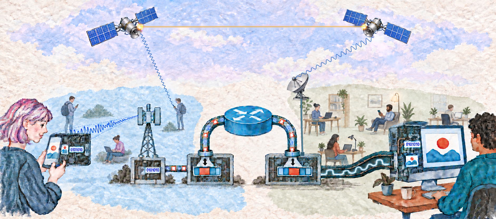

::: {.home-cover}
::: {.home-overline}
ОПИСиС · Учебный курс
:::

# Основы построения инфокоммуникационных систем и сетей {.home-title .unnumbered}

::: {.home-subtitle}
От физического сигнала до сквозной доставки информации через сеть
:::

```{=html}
<div class="home-actions">
<a class="home-start" href="lectures/00-introduction.qmd">Начать изучение →</a>
<a class="home-repository" href="https://github.com/temaSW/intro-to-networking"><i class="bi bi-github" aria-hidden="true"></i> Репозиторий проекта →</a>
</div>
```


:::

## О курсе

Как информация становится физическим сигналом, проходит через каналы связи, промежуточные узлы и транспортную инфраструктуру — и достигает получателя? Курс посвящён принципам построения инфокоммуникационных систем и сетей и инженерным задачам, которые стоят за этим путём.

Мы рассмотрим передачу данных, использование ограниченных ресурсов, обеспечение надёжности, организацию доступа и доставки информации через сеть. Wi-Fi, 5G, Ethernet, IP, SDH и другие технологии послужат примерами разных способов решения этих задач.

## Материалы курса

```{=html}
<div class="home-materials">
<a class="home-material" href="lectures/index.qmd"><i class="bi bi-book" aria-hidden="true"></i><span class="home-material-title">Лекции</span><span>Теоретические материалы, инженерные принципы и примеры реальных систем.</span><span class="home-material-action" aria-hidden="true">Открыть лекции →</span></a>
<a class="home-material" href="practice/index.qmd"><i class="bi bi-pencil-square" aria-hidden="true"></i><span class="home-material-title">Практические занятия</span><span>Расчётные задачи, анализ систем и сравнение инженерных решений.</span><span class="home-material-action" aria-hidden="true">Перейти к практике →</span></a>
<a class="home-material" href="labs/index.qmd"><i class="bi bi-beaker" aria-hidden="true"></i><span class="home-material-title">Лабораторные работы</span><span>Эксперименты, исследование характеристик и поведения систем.</span><span class="home-material-action">Материалы готовятся →</span></a>
<a class="home-material" href="reference/index.qmd"><i class="bi bi-journal-text" aria-hidden="true"></i><span class="home-material-title">Справочник</span><span>Децибелы, комплексные числа и звук через шумный канал.</span><span class="home-material-action" aria-hidden="true">Открыть справочник →</span></a>
</div>
```

:::: {.home-details}

## Информация о дисциплине

| Параметр | Значение |
|---|---|
| Направление подготовки | 11.03.02 «Инфокоммуникационные технологии и системы связи» |
| Общая трудоёмкость | 144 часа |
| Зачётные единицы | 4 з. е. |
| Форма промежуточной аттестации | Экзамен |

## Трудоёмкость дисциплины

Все значения приведены в академических часах.

```{=html}
<div class="home-hours" role="img" aria-label="Распределение 144 академических часов: лекции — 26, практика — 18, лабораторные — 16, самостоятельная работа — 48, подготовка и сдача экзамена — 36.">
<span class="hours-lectures" style="flex:26" title="Лекции — 26 часов"></span><span class="hours-practice" style="flex:18" title="Практические занятия — 18 часов"></span><span class="hours-labs" style="flex:16" title="Лабораторные работы — 16 часов"></span><span class="hours-self" style="flex:48" title="Самостоятельная работа — 48 часов"></span><span class="hours-exam" style="flex:36" title="Подготовка и сдача экзамена — 36 часов"></span>
</div>
```

<table class="table home-hours-table">
<thead><tr><th scope="col">Вид учебной работы</th><th scope="col">Часы</th></tr></thead>
<tbody>
<tr><th scope="row"><span class="hours-key hours-lectures" aria-hidden="true"></span>Лекции</th><td>26</td></tr>
<tr><th scope="row"><span class="hours-key hours-practice" aria-hidden="true"></span>Практические занятия</th><td>18</td></tr>
<tr><th scope="row"><span class="hours-key hours-labs" aria-hidden="true"></span>Лабораторные работы</th><td>16</td></tr>
<tr><th scope="row"><span class="hours-key hours-self" aria-hidden="true"></span>Самостоятельная работа</th><td>48</td></tr>
<tr><th scope="row"><span class="hours-key hours-exam" aria-hidden="true"></span>Подготовка и сдача экзамена</th><td>36</td></tr>
</tbody>
<tfoot><tr><th scope="row">Всего</th><td><strong>144</strong></td></tr></tfoot>
</table>

::::

## Рекомендуемая литература

```{=html}
<div class="home-reading" role="region" aria-label="Рекомендуемая литература" tabindex="0">
<table class="table home-reading-table">
<thead><tr><th scope="col">Книга и авторы</th><th scope="col">Ссылка</th><th scope="col">Чем полезна</th></tr></thead>
<tbody>
<tr><th scope="row"><strong>Цифровая связь. Теоретические основы и практическое применение</strong><span class="home-book-authors">Б. Скляр</span></th><td><a href="https://www.williamspublishing.com/Books/978-5-8459-2071-3.html">Страница книги</a></td><td>Полезна для изучения цифрового представления и передачи информации, сигналов и спектров, цифровой модуляции, шума и помех, помехоустойчивости и общих принципов построения цифровых систем связи.</td></tr>
<tr><th scope="row"><strong>Цифровая связь</strong><span class="home-book-authors">Дж. Прокис</span></th><td><a href="https://search.rsl.ru/ru/record/01000683910">Библиографическая запись</a></td><td>Полезна для углублённого изучения математических моделей цифровой передачи, анализа сигналов, каналов связи и модуляции, оценки качества передачи и методов повышения надёжности.</td></tr>
<tr><th scope="row"><strong>Компьютерные сети</strong><span class="home-book-authors">Э. Таненбаум, Н. Фимстер, Д. Уэзеролл</span></th><td><a href="https://www.piter.com/product/kompyuternye-seti-6-e-izd">Страница книги</a></td><td>Полезна для изучения архитектуры сетей, канального и сетевого уровней, коммутации пакетов, адресации, маршрутизации и организации доставки данных.</td></tr>
</tbody>
</table>
</div>
```

## Как мы работаем в этом курсе

### Инженерная культура

- **Понимание важнее готового ответа.**
- **Результаты требуют проверки.**
- **У любого решения есть ограничения.**
- **Ошибки и неопределённость -- часть инженерной работы.**
- **Ответственность остаётся за человеком.**

### Общение и совместная работа

- **Сначала думаем, затем обсуждаем.**
- **Вопросы -- по поднятой руке; отвечать можно без руки.**
- **«Я не понял», «Я не знаю» и «Мы не знаем» -- это нормально.**
- **Глупых вопросов нет.**

### Использование искусственного интеллекта

**ИИ разрешён по умолчанию, если условия конкретного задания не предусматривают ограничений.** Он может помогать разобраться в материале, проверить собственное решение и оформить работу. Примеры ниже показывают границу: ИИ помогает вашей работе, а содержательные рассуждения и выводы вы готовите самостоятельно.

```{=html}
<table class="table home-ai-table">
<thead><tr><th scope="col">Допустимо</th><th scope="col">Недопустимо</th></tr></thead>
<tbody>
<tr><td>Просить объяснить понятие, формулу или непонятный фрагмент материала</td><td>Сдавать готовый ответ, который вы не можете объяснить и обосновать</td></tr>
<tr><td>Получать подсказки к своей попытке решения, чтобы продолжить самостоятельно</td><td>Поручать ИИ выполнение задания вместо самостоятельного решения</td></tr>
<tr><td>Искать ошибки в своих расчётах и рассуждениях, разбирать предложенные исправления</td><td>Принимать ответы ИИ без проверки или выдавать выдуманные измерения и результаты за реальные</td></tr>
<tr><td>Оформлять отчёт на основе собственного текста и полученных данных</td><td>Поручать ИИ написание отчёта целиком</td></tr>
<tr><td>Исправлять язык и улучшать стилистику своего текста, сохраняя смысл</td><td>Поручать ИИ содержательные рассуждения и выводы по работе</td></tr>
</tbody>
</table>
```

**Вы можете использовать любые разрешённые инструменты, включая искусственный интеллект. Но ответственность за достоверность результата и его понимание остаётся за вами.**

## Обратная связь

Нашли неточность, придумали улучшение или хотите разобраться в материале? Сообщения помогают исправлять курс, выбирать полезные дополнения и уточнять объяснения. В правом верхнем углу каждой страницы есть три кнопки, которые открывают Google Forms:

```{=html}
<div class="home-feedback">
<article class="home-feedback-card"><div class="home-feedback-heading"><span class="home-feedback-icon" data-feedback-icon="error" aria-hidden="true"><i class="bi bi-bug" aria-hidden="true"></i></span><h3>Сообщить об ошибке</h3></div><p>Опечатка, неверная формула, неработающая ссылка или модель ведёт себя не так, как описано. Укажите страницу, что произошло и какой результат ожидался. Для модели добавьте параметры и шаги воспроизведения.</p><a data-course-feedback="error" href="https://docs.google.com/forms/d/e/1FAIpQLScbsWOaqw31Cs30H-o3cjq4DoBKEsViXSzSD4I5BL1WjgEKfg/viewform" target="_blank" rel="noopener noreferrer">Форма ошибки →</a></article>
<article class="home-feedback-card"><div class="home-feedback-heading"><span class="home-feedback-icon" data-feedback-icon="improvement" aria-hidden="true"><i class="bi bi-lightbulb" aria-hidden="true"></i></span><h3>Предложить улучшение</h3></div><p>Не хватает примера, хочется исследовать другой сценарий или есть идея для объяснения. Укажите тему и расскажите, какую задачу решит дополнение и что предлагаете изменить.</p><a data-course-feedback="improvement" href="https://docs.google.com/forms/d/e/1FAIpQLSc70niaI42Az7F9qNkiEeF9JAoNoPknDjI07u4-hGrBYuqM-Q/viewform" target="_blank" rel="noopener noreferrer">Форма предложения →</a></article>
<article class="home-feedback-card"><div class="home-feedback-heading"><span class="home-feedback-icon" data-feedback-icon="question" aria-hidden="true"><i class="bi bi-question-circle" aria-hidden="true"></i></span><h3>Задать вопрос</h3></div><p>Неясен шаг объяснения, условие задачи или результат эксперимента. Укажите страницу и конкретный фрагмент, расскажите, что уже понятно и где возникает затруднение.</p><a data-course-feedback="question" href="https://docs.google.com/forms/d/e/1FAIpQLSeF4BRW5MGA_C1SvuoBoP2nhr4O8fRkI7xRpUPRTcFhe3KEXA/viewform" target="_blank" rel="noopener noreferrer">Форма вопроса →</a></article>
</div>
```

::: {.course-block .course-important}
**Важно**

Перед тем как задать вопрос, сначала подумайте над ним самостоятельно, поищите ответ в материалах курса и других доступных источниках, обсудите его с одногруппниками. Если после этого вопрос остаётся открытым, задайте его через форму. Расскажите, что уже удалось выяснить и в чём осталось затруднение; укажите источники, на которые опираетесь.

Цель этого порядка — развивать умение **самостоятельно обучаться**: проверять своё понимание, находить нужную информацию, сопоставлять объяснения и замечать пробелы в рассуждении. Попробуйте объяснить ход решения своими словами — себе или одногруппнику: это помогает точнее определить, на каком шаге нужна помощь.

:::
