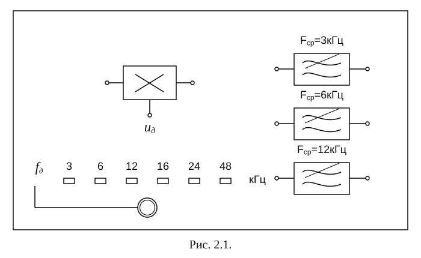
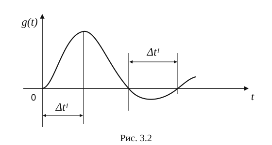

[Скачать PDF](pdf/discretization-kotelnikov.pdf){.lab-download download="discretization-kotelnikov.pdf"}

## 1. Цель работы.

Исследование процессов дискретизации и восстановления непрерывных сигналов.

## 2. Краткая характеристика исследуемых цепей и сигналов

Исследуемое устройство (рис. 2.1) размещено на сменном блоке ТЕОРЕМА КОТЕЛЬНИКОВА и представляет собой дискретизатор (обозначенный на макете как перемножитель сигналов) и набор из трех фильтров - восстановителей с разными частотами среза. Источники исследуемых сигналов - S1, S2 и S3 находятся в блоке ИСТОЧНИКИ СИГНАЛОВ, а сами сигналы представляют собой суммы гармоник с частотами 2, 4 и 6кГц. (При необходимости исследуемый сигнал может быть усложнен добавлением еще одного гармонического сигнала с частотой 1кГц с помощью сумматора стенда).

::: {.lab-figure tabindex="0" role="region" aria-label="Рис. 2.1."}

:::

Дискретизатор, формирующий отсчеты $s(k\Delta t)$ непрерывного сигнала $s(t)$, выполняет функцию перемножителя этого сигнала на короткие импульсы напряжения дискретизации ($u_{\text{дискр}}$). В данном случае дискретизатор выполнен по схеме аналогового коммутатора, пропускающего входной сигнал $s(t)$ на выход в течение короткого времени существования импульсов дискретизации. Временной интервал между соседними отсчетами дискретизированного сигнала $s(k\Delta t)$ зависит от выбора частоты дискретизации $f_{\text{д}}$:

$$\Delta t=\frac{1}{f_{\text{д}}}.$$

Эта частота может изменяться дискретно при нажатии кнопки $f_{\text{д}}$, при этом выбранное значение этой частоты индицируется светодиодом ($f_{\text{д}}=3,6,12,16,24\ \text{и}\ 48\,\text{кГц}$). Все упомянутые выше частоты (частоты дискретизации и частоты гармоник исследуемых сигналов) жестко синхронизированы, что упрощает наблюдение процессов на осциллографе.

В качестве фильтров - восстановителей используются три активных ФНЧ четвертого порядка с частотами среза 3, 6 и 12 кГц. Для снятия импульсных характеристик фильтров используется генератор коротких импульсов "$\delta$ - функций" (гнезда $\delta(t)$ в блоке ИСТОЧНИКИ СИГНАЛОВ).

В соответствии с теоремой Котельникова отсчеты, следующие через интервалы времени $\Delta t=\frac{1}{2F_{\text{в}}}$, где $F_{\text{в}}$ - верхняя частота сигнала, могут быть преобразованы в исходный сигнал после прохождения через идеальный ФНЧ с частотой среза $F_{\text{ср}}=F_{\text{в}}$. В работе используются реальные ФНЧ с достаточно крутыми спадами АЧХ после частоты среза. Поэтому на практике выбирают $\Delta t$ несколько меньше (а иногда и в несколько раз меньше), чем требуется в теореме Котельникова с тем, чтобы реальный ФНЧ с АЧХ трапециевидной формы позволял выделить спектр исходного сигнала из спектра дискретизированного сигнала, что гарантирует отсутствие искажений при обратном преобразовании (восстановлении) сигнала.

В качестве измерительных приборов используются двухлучевой осциллограф и ПК, работающий в режиме анализатора спектра.

## 3. Лабораторное задание

1. Произвести дискретизацию одного из сложных сигналов ($s_1$, $s_2$ или $s_3$).
2. Исследовать спектры исходного и дискретизированного сигналов.
3. Исследовать частотные и импульсные характеристики фильтров -- восстановителей.
4. Исследовать процесс восстановления дискретизированных сигналов.

## 4. Порядок выполнения работы

### 1. Дискретизация сигнала.

1.1. Выбрать один из трех сигналов (например, $s_1$) в блоке ИСТОЧНИКИ СИГНАЛОВ и подать его на вход "А" ПК, работающего в режиме спектроанализатора. (Входы ПК находятся в нижней части стенда справа).

1.2. С помощью спектроанализатора (ПК) получить спектр сигнала и определить его верхнюю частоту ($F_{\text{в}}$).

1.3. Учитывая, что значения частот дискретизации ($f_{\text{д}}$), указанные на сменном блоке, являются ориентировочными, провести спектральный анализ сигналов $U_{\text{д}}$ (гнездо под перемножителем). Определив частоты первых гармоник этих сигналов при установке $f_{\text{д}}=3,6,12\ \text{и}\ 16\,\text{кГц}$, внести уточненные значения в таблицу 3.1.

Таблица 3.1

Уточненные частоты дискретизации ($f_{\text{д}}$).

::: {.course-table-wrap .lab-table tabindex="0" role="region" aria-label="Таблица 1"}

| Обозначение на блоке | кГц | 3 | 6 | 12 | 16 | 24 | 48 |
| --- | --- | --- | --- | --- | --- | --- | --- |
| Измеренные величины | кГц | | | | | | |

:::

Для частот более 24 и 48 кГц спектральный анализ в данной работе невозможен (т.к. $F_{\max}=24\,\text{кГц}$), поэтому их следует умножить на тот же коэффициент, который связывает указанные на блоке и уточненные значения частот дискретизации. (Этот коэффициент -- примерно 1,15 -- может быть уточнен по первым четырем значениям $f_{\text{д}}$).

1.4. Рассчитать требуемую частоту дискретизации $f_{\text{д}}^1$ и установить ее на макете кнопкой "$f_{\text{д}}$".

1.5. Соединить входы двухлучевого осциллографа со входом и выходом дискретизатора, установить режим внешней синхронизации осциллографа (от гнезда С1 блока ИСТОЧНИКИ). Вход спектроанализатора подключить к выходу дискретизатора.

1.6. Зафиксировать в отчете временные диаграммы в следующем порядке (с сохранением масштаба по оси времени)

- исследуемый сигнал $s(t)$;
- напряжение дискретизации (гнездо нижнего входа перемножителя);
- выходной дискретизированный сигнал $s(k\Delta t)$.

С экрана монитора ПК зарисовать спектры перечисленных выше сигналов.

1.7. Переключая кнопкой частоту дискретизации $f_{\text{д}}$ на 1-2 шага выше и ниже выбранного значения $f_{\text{д}}^1$, наблюдать изменения в осциллограммах и спектрах на выходе дискретизатора. Наиболее характерные случаи зафиксировать в отчете.

### 2. Исследование фильтров.

С целью выбора наилучшего из трех ФНЧ в качестве фильтра - восстановителя необходимо определить частоту среза каждого из них по АЧХ либо по импульсной характеристике $g(t)$. Кроме того, АЧХ фильтров необходима для последующей коррекции $f_{\text{д}}$, а импульсная реакция $g(t)$ нужна для объяснения процесса восстановления сигнала.

2.1. Снятие АЧХ фильтра проводиться путем подачи на его вход гармонического сигнала с напряжением 1В и с частотой 1кГц от встроенного генератора в блоке ИСТОЧНИКИ СИГНАЛОВ. К выходу фильтра подключить встроенный цифровой вольтметр переменного напряжения. Плавно увеличивая частоту генератора, снять частотную характеристику $U_{\text{вых}}=\varphi(f)$ с шагом 1-2кГц так, чтобы зафиксировать частоту среза $F_{\text{с}}$, на которой $U_{\text{вых}}$ окажется в $\sqrt{2}$ раз меньше, чем на частоте 1кГц, а также частоты, на которых $U_{\text{вых}}$ уменьшится до 0,1 и 0,05 от $U_{\text{вых}}(1\,\text{кГц})$. Построить на одном графике АЧХ трех фильтров и отметить на них уточненные значения частот среза $F_{\text{с}}$. Выбрать лучший фильтр - восстановитель для исследуемого сигнала.

2.2. Снятие импульсной реакции ФНЧ производится путем подачи на вход фильтра коротких импульсов (от гнезда "$\delta(t)$" блока "ИСТОЧНИКИ"). Осциллограмма выходного сигнала будет соответствовать импульсной реакции фильтра $g(t)$.

Зарисовать осциллограммы $g(t)$ для трех фильтров, фиксируя на них значения "нулей" (рис. 3.2) по шкале на экране осциллографа с учетом масштаба развертки (мкс/дел).

Определив $\Delta t^1$ для каждого ФНЧ, находим частоты среза по формуле:

$$F_{\text{с}}=\frac{1}{2\Delta t^1}.$$

::: {.lab-figure .lab-figure-compact tabindex="0" role="region" aria-label="Рис. 3.2"}

:::

2.3. По результатам измерений в пунктах 2.1 или 2.2 выбрать фильтр, наиболее пригодный для восстановления дискретизированного сигнала.

### 3. Восстановление дискретизированного сигнала.

3.1. Сопоставляя спектры, снятые по п.1.6 с частотной характеристикой выбранного фильтра - восстановителя, скорректировать частоту дискретизации, увеличив ее на 1 - 2 шага от расчетного значения с тем, чтобы спектр исходного сигнала $s(t)$ можно было выделить из спектра дискретизированного сигнала с помощью выбранного реального ФНЧ.

3.2. Соединить выход дискретизатора со входом выбранного ФНЧ, установить на макете уточненное в п.3.1. значение $f_{\text{д}}^1$. Подключив один из входов осциллографа ко входу дискретизатора, а второй - к выходу ФНЧ, зафиксировать в отчете осциллограммы исходного и восстановленного сигнала.

3.3. Изменяя частоту дискретизации на 1 - 2 шага от скорректированного значения $f_{\text{д}}$, зафиксировать наиболее характерные осциллограммы восстановленных сигналов. В отчете привести заключение о том, допустимо ли изменять интервал между отсчетами дискретизированного сигнала ($\Delta t$).

3.4. Установив прежнее значение $f_{\text{д}}^1$, заменить выбранный ФНЧ на другой, а затем и на третий фильтр, фиксируя в отчете осциллограммы восстановленных сигналов с указанием $F_{\text{с}}$ ФНЧ.

3.5. Соедините вход дискретизатора с источником периодической последовательности прямоугольных импульсов, в качестве которого используется КОДЕР-1. Установите тумблерами КОДЕРА-1 любую комбинацию из одной единицы и четырех нулей. При этом на выходе КОДЕРА-1 формируются прямоугольные импульсы длительностью 450 мкс с периодом 7650 мкс. Проведя анализ спектра этого сигнала, выберите $f_{\text{д}}$ и фильтр - восстановитель. Зафиксируйте осциллограммы и спектры входного, дискретизированного и восстановленного сигналов.

## 5. Порядок оформления отчета

Отчет должен содержать следующие сведения.

1. Функциональную схему установки.
2. Осциллограммы, спектры и характеристики фильтров по всем пунктам задания.
3. Выводы по пунктам 3.3 и 3.5.

Выводы по работе должны включать:

1. Оценка уровня работы и ее полезности для изучения темы
2. Замечания по усовершенствованию программы

## 6. Контрольные вопросы

1. Каков практический смысл в дискретизации аналоговых сигналов?
2. Сформулируйте теорему Котельникова.
3. При каких условиях теорема Котельникова гарантирует двойное преобразование сигналов (дискретизация и восстановление) без искажений?
4. Могут ли быть дискретизированы и затем восстановлены импульсы прямоугольной формы?
5. Каков алгоритм восстановления дискретизированного сигнала?
6. Какова роль ряда Котельникова в объяснении процесса восстановления сигнала?
7. Что такое базисная функция?
8. Какую функцию выполняет ФНЧ?
9. С какой целью в работе исследовались спектры исходного и дискретизированного сигналов?
10. Можно ли произвольно увеличивать или уменьшать $\Delta t$ между отсчетами? К чему это может привести?
11. В чем отличие идеального и реального ФНЧ?
12. С чем связана необходимость корректировать значение частоты дискретизации?
13. Как Вы представляете себе процесс дискретизации аналогового сигнала? Какие функциональные узлы для этого необходимы?
14. Все ли аналоговые сигналы могут быть:
    - дискретизированы во времени;
    - восстановлены после дискретизации.
15. Назовите причины, вызывающие искажения при восстановлении дискретизированных сигналов.
