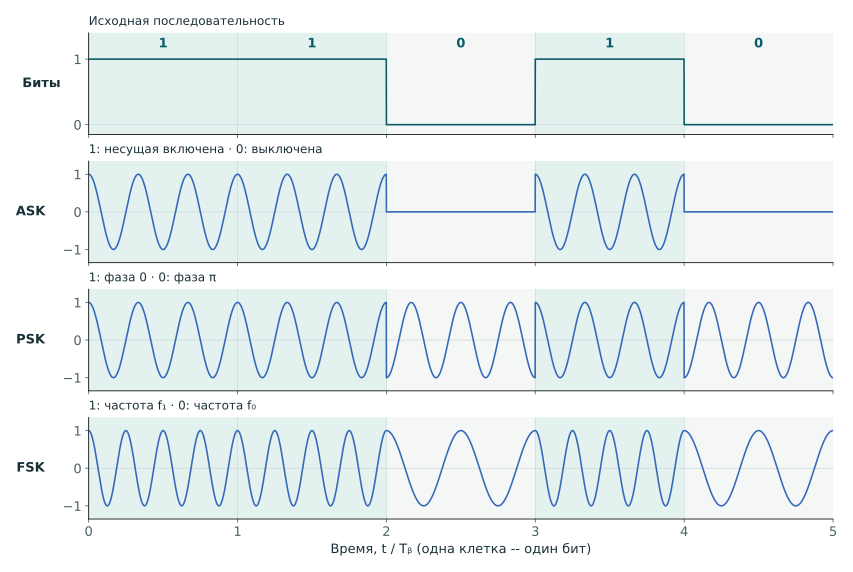
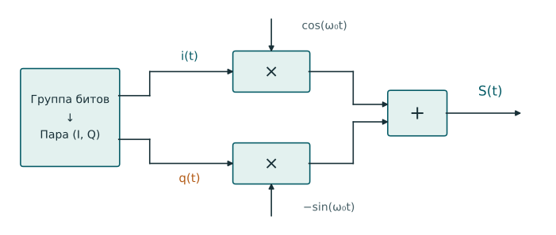
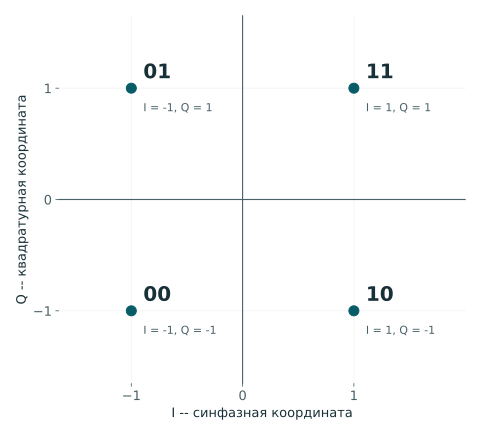
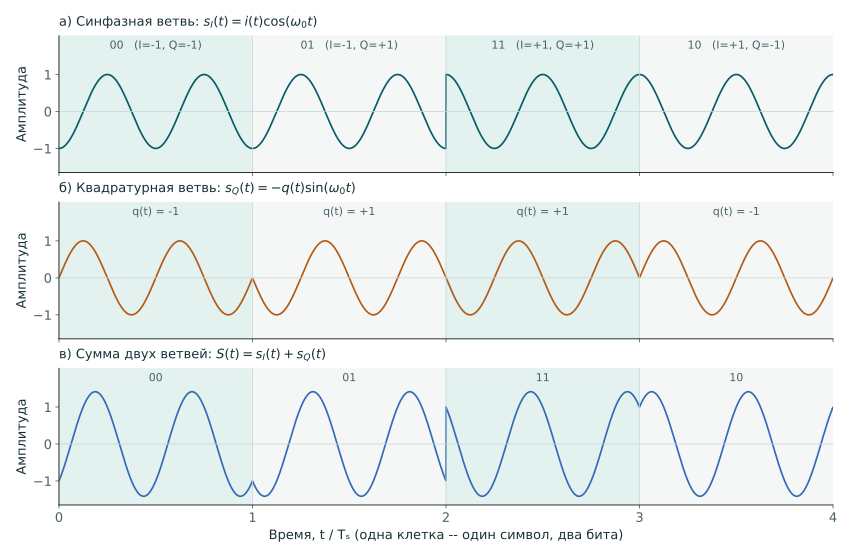
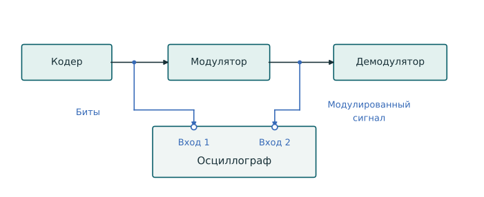
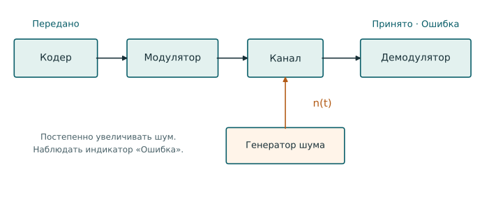

[Скачать PDF](pdf/modulation.pdf){.lab-download download="modulation.pdf"}

**Цель работы:** изучение основных видов цифровой манипуляции (фазовой, амплитудной, частотной).

**Задачи:**

1. Изучить осциллограммы на выходе модулятора.
2. Изучить блоки демодулятора (умножитель, интегратор, сумматор, решающее устройство (РУ)).
3. Изучить то, как шум влияет на передачу сигнала.

## Теоретическая часть

В цифровых системах связи применяются цифровые виды модуляции (манипуляции), такие, как FSK, PSK, ASK (frequency, phase, amplitude shift keying, частотная, фазовая, амплитудная манипуляция), QAM (quadrature amplitude modulation, квадратурная амплитудная модуляция), и др.

Рассмотрим подробнее данные виды манипуляции (рисунок 1).

::: {.lab-figure tabindex="0" role="region" aria-label="Временное представление двухпозиционных FSK, PSK, ASK сигналов"}

:::

Рисунок 1 -- одна и та же последовательность «11010» при ASK, PSK и FSK. Вертикальные линии отмечают границы битов; амплитуды нормированы. Частоты выбраны для наглядности, а не по параметрам макета.

В зависимости от вида манипуляции изменяется амплитуда, частота или фаза несущего колебания. В рассматриваемой идеализированной модели параметры задаются постоянными на интервале символа и могут изменяться на его границах. Сам сигнал при этом не обязательно имеет скачки: например, возможна частотная манипуляция с непрерывной фазой.

Позиционность (порядок) модуляции $M$ -- число возможных символов модуляции. Если каждому символу соответствует группа из $k$ бит и $M=2^k$, то

$$
k=\log_2 M,\qquad R_s=\frac{R_b}{k},
$$

где $R_b$ -- битовая скорость на входе модулятора, бит/с, а $R_s$ -- символьная скорость, символ/с (бод).

Ниже приведены двухпозиционные варианты ASK, FSK и PSK. Пусть $b_n\in\{0,1\}$ -- передаваемый бит с номером $n=0,1,\ldots,N-1$. $A>0$ -- амплитуда несущего колебания, $f_c$ -- несущая частота, $t$ -- время.

### ASK: амплитудная манипуляция

Для варианта с включением и выключением несущей (on-off keying, OOK):

$$
s(t)=m(t)A\cos(2\pi f_c t)=
\begin{cases}
A\cos(2\pi f_c t), & b_n=1,\\
0, & b_n=0,
\end{cases}
\qquad m(t)=b_n.
$$

Это частный случай ASK: в общем случае оба уровня амплитуды могут быть ненулевыми.

### FSK: частотная манипуляция

$$
s(t)=
\begin{cases}
A\cos(2\pi f_1 t), & b_n=1,\\
A\cos(2\pi f_0 t), & b_n=0,
\end{cases}
\qquad f_1\ne f_0.
$$

Здесь $f_1$ и $f_0$ -- частоты, соответствующие битам 1 и 0.

### PSK: фазовая манипуляция

Для двухпозиционной фазовой манипуляции (BPSK):

$$
s(t)=m(t)A\cos(2\pi f_c t)=
\begin{cases}
A\cos(2\pi f_c t), & b_n=1,\\
A\cos(2\pi f_c t+\pi), & b_n=0,
\end{cases}
\qquad m(t)=2b_n-1.
$$

Двум битовым значениям соответствуют фазы, отличающиеся на $\pi$ радиан.

### QAM: квадратурная амплитудная модуляция

Квадратурное представление сигнала можно получить, используя формулу косинуса суммы двух аргументов:

$$
S(t) = A(t)\cos(\omega_0 t+\varphi(t)) = A(t)[\cos\omega_0 t\cdot\cos\varphi(t)-\sin\omega_0 t\cdot\sin\varphi(t)]
$$

Здесь $A(t)$ -- амплитудная огибающая, $\varphi(t)$ -- фаза относительно несущей, $\omega_0=2\pi f_c$ -- угловая частота несущего колебания. В этой записи можно сделать замену:

$$
i(t) = A(t)\cdot\cos\varphi(t)
$$

$$
q(t) = A(t)\cdot\sin\varphi(t)
$$

Тогда квадратурный сигнал может быть записан в виде:

$$
S(t) = i(t)\cdot\cos\omega_0 t-q(t)\cdot\sin\omega_0 t,
$$

где $i(t)$ и $q(t)$ (могут быть записаны как $I$ и $Q$) -- синфазная и квадратурная огибающие (квадратуры).

QAM-модуляция основана на отображении группы битов в пару значений $I$ и $Q$. В этом случае QAM-модулятор может иметь вид, приведенный на рисунке 2.

::: {.lab-figure tabindex="0" role="region" aria-label="QAM-модулятор"}

:::

Рисунок 2 -- QAM-модулятор: две ветви умножают квадратуры на опорные колебания, затем результаты складываются.

Блок отображения битов в значения $i(t)$ и $q(t)$ может быть описан таблицей соответствия между реализацией группы битов и $i(t)$ и $q(t)$. Для модуляции QAM-4 (эквивалентной QPSK при соответствующем выборе фазы и нормировки) это соответствие приведено в таблице 1.

Таблица 1 -- QAM-4 (QPSK) модуляция

::: {.course-table-wrap .lab-table tabindex="0" role="region" aria-label="Таблица 1"}

| Входные биты | $i(t)$ | $q(t)$ |
| --- | --- | --- |
| 00 | -1 | -1 |
| 01 | -1 | 1 |
| 10 | 1 | -1 |
| 11 | 1 | 1 |

:::

Также соответствие между битами и значениями $i(t)$ и $q(t)$ можно продемонстрировать с помощью диаграммы «Созвездие», оси которой соответствуют квадратурам, а точки соответствуют возможным символам модуляции (комбинациям $i(t)$ и $q(t)$). Созвездие для модуляции QAM-4 (QPSK) приведено на рисунке 3.

::: {.lab-figure .lab-figure-compact tabindex="0" role="region" aria-label="Диаграмма «Созвездие» модуляции QAM-4"}

:::

Рисунок 3 -- созвездие QAM-4. У каждой точки указаны два передаваемых бита и координаты из таблицы 1.

Физически процесс модуляции можно представить следующим образом (рисунок 4).

::: {.lab-figure tabindex="0" role="region" aria-label="Квадратурная модуляция"}

:::

Рисунок 4 -- квадратурная модуляция: а) синфазная ветвь $s_I(t)=i(t)\cos\omega_0t$; б) квадратурная ветвь $s_Q(t)=-q(t)\sin\omega_0t$; в) результирующий сигнал $S(t)=s_I(t)+s_Q(t)$. Огибающие $i(t)$ и $q(t)$ принимают значения из таблицы 1; $T_s$ -- длительность символа QAM-4.

### Демодуляция QAM-4

При когерентной демодуляции принятый сигнал умножают на согласованные по частоте и фазе опорные колебания $\cos\omega_0t$ и $-\sin\omega_0t$. После фильтрации или интегрирования на интервале символа и нормировки получают оценки квадратур $\hat I$ и $\hat Q$. Для прямоугольных символов опорные функции должны быть ортогональны на интервале интегрирования. Решение по квадранту принимают по этим оценкам.

Для созвездия на рисунке 3 и соответствия в таблице 1 пороги равны нулю:

::: {.course-table-wrap .lab-table tabindex="0" role="region" aria-label="Таблица 2"}

| Квадрант | Оценка I | Оценка Q | Переданные биты |
| --- | --- | --- | --- |
| Левый верхний | Отрицательная | Положительная | 01 |
| Правый верхний | Положительная | Положительная | 11 |
| Правый нижний | Положительная | Отрицательная | 10 |
| Левый нижний | Отрицательная | Отрицательная | 00 |

:::

Для точки точно на пороге нужно заранее выбрать правило разрешения равенства. Например, нулевую оценку можно относить к положительной полуплоскости: первый бит равен 1 при $\hat I\ge0$, второй -- при $\hat Q\ge0$.

## Ход работы

Работа выполняется на макете для трёх видов манипуляции: ASK (АМ), PSK (ФМ) и FSK (ЧМ). Использовать кодер, модулятор, канал, демодулятор, индикацию «Передано» и «Принято», индикатор «Ошибка» и двухканальный осциллограф.

### 1. Подготовка тракта без шума

Включить установку. Установить пятиразрядное кодовое слово «10000» и режим ASK. Собрать тракт кодер → модулятор → демодулятор без добавления шума. Для наблюдения входа и выхода модулятора использовать подключение по рисунку 5.

::: {.lab-figure tabindex="0" role="region" aria-label="Схема №1: кодер, модулятор, осциллограф"}

:::

Рисунок 5 -- подключение осциллографа для наблюдения входа и выхода модулятора

Проверить совпадение слов «Передано» и «Принято» и отсутствие индикации ошибки. При сравнении осциллограмм исходной и восстановленной последовательностей учитывать задержку прохождения сигнала через тракт.

### 2. Исследование ASK

Одновременно наблюдать исходную битовую последовательность и выход модулятора. Зафиксировать осциллограммы на общей временной шкале, отметить границы битов и определить, какие участки сигнала соответствуют нулю и единице.

Последовательно подключить осциллограф к доступным выходам умножителей и интеграторов демодулятора. Зафиксировать осциллограммы и сопоставить их с теми же битами исходного слова. Для выхода интегратора обратить внимание на значение к концу битового интервала. Объяснить, какой признак позволяет различить ноль и единицу.

Сравнить исходную последовательность с выходом решающего устройства и показаниями «Принято». Связать восстановленные биты с наблюдаемыми значениями на выходах интеграторов.

### 3. Исследование PSK

Переключить макет в режим PSK. Для слова «10000» повторить наблюдения входа и выхода модулятора, выходов умножителей, интеграторов и решающего устройства.

На осциллограмме модулированного сигнала отметить изменение фазы при переходах между нулём и единицей. Определить, чем отличаются результаты интегрирования для этих битов. Объяснить, как наблюдаемые значения связаны с решением приёмника. Проверить совпадение переданного и принятого слов.

### 4. Исследование FSK

Переключить макет в режим FSK. Для слова «10000» определить частоты, соответствующие нулю и единице.

Одновременно наблюдать выходы двух умножителей, затем выходы двух интеграторов. Сопоставить отклики ветвей с одним и тем же передаваемым битом. Определить, какая ветвь сильнее откликается на каждую из двух частот, и объяснить, как сравнение результатов позволяет восстановить бит. Зафиксировать осциллограммы и проверить совпадение переданного и принятого слов.

### 5. Влияние кодового слова на сигнал и спектр

В режиме ASK задать слово «10000». Посмотреть и зафиксировать осциллограмму и спектр на выходе модулятора.

Последовательно задать слова «11000», «11100» и «11110». Для каждого слова зафиксировать осциллограмму и спектр, сравнить их с предыдущими. По осциллограммам проследить, как соседние единицы образуют более длинный участок включённой несущей. Длительность отдельного бита при этом сохраняется.

Описать, как меняется спектр при изменении кодового слова. Для повторяющихся слов спектр не обязательно сужается с каждой добавленной единицей: вывод сделать по наблюдаемой картине.

В режимах PSK и FSK также исследовать эти кодовые слова: сравнить сигналы на выходе модулятора и выходах интеграторов, проверить правильность восстановления слов.

### 6. Влияние шума

Собрать тракт с каналом и генератором шума (ГШ) по рисунку 6. Выбрать одно из исследованных слов, содержащее нули и единицы, и указать его в отчёте.

::: {.lab-figure tabindex="0" role="region" aria-label="Схема №2: кодер, модулятор, канал, демодулятор и ГШ"}

:::

Рисунок 6 -- тракт передачи с добавлением шума в канале

Для каждого вида манипуляции сначала проверить передачу без добавленного шума, затем постепенно увеличивать его уровень. Наблюдать сигнал после канала, выходы интеграторов и индикатор «Ошибка». Сопоставить осциллограммы без шума и с шумом, отметить появление индикации ошибок и объяснить, как изменения результатов интегрирования мешают различать символы.

Контроль ошибок выполнять качественно по индикатору «Ошибка».
### 7. Оформление результатов

Осциллограммы и спектры можно зафиксировать сохранением изображения с осциллографа или фотографией его экрана.

В отчёт включить схемы соединений, исследованные кодовые слова, осциллограммы с указанием точек наблюдения, спектры ASK для разных кодовых слов. Для каждого вида манипуляции объяснить на примере конкретного бита, как он представлен на выходе модулятора, какие признаки наблюдаются после умножения и интегрирования и какое решение принимает приёмник.

В выводах описать изменения сигнала и спектра при смене кодового слова, объяснить различие между длительностью бита и длительностью участка из нескольких одинаковых битов, а также описать влияние шума на работу демодулятора.

## Контрольные вопросы

1. Чем отличаются разные виды модуляции?
2. Как связана символьная и битовая скорость?
3. Как связана ширина полосы и длительность сигнала?
4. Что показывает диаграмма «созвездие»?
5. Что происходит с увеличением мощности шума в канале?
