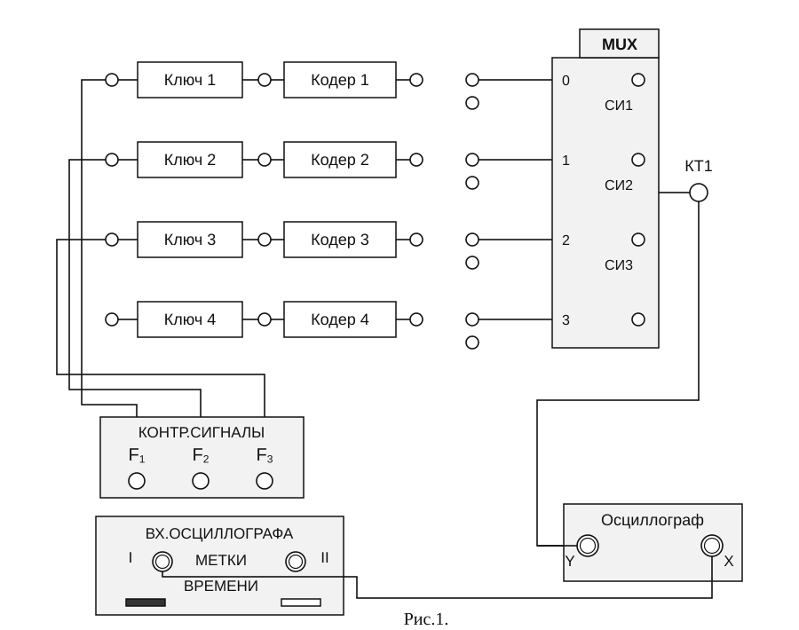
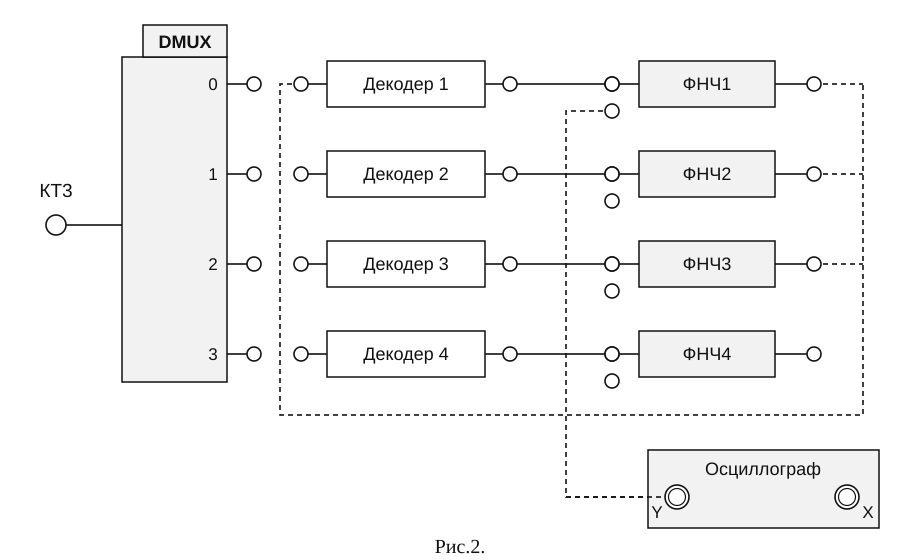

[Скачать PDF](pdf/pcm-communication-system.pdf){.lab-download download="pcm-communication-system.pdf"}

## 1. Цель работы

1. Ознакомиться с примером построения системы связи с временным разделением каналов и импульсно-кодовой модуляцией (ИКМ).
2. Сформировать заданное множество сигналов с ИКМ. Изучить их особенности и определить параметры.
3. Получить и исследовать групповой сигнал из сигналов с ИКМ, применяя временное разделение каналов.
4. Проконтролировать процесс разделения сигналов с ИКМ в приемной части установки. Оценить качество разделения.
5. Оценить качество восстановления передаваемых сигналов с помощью фильтров низких частот.

## 2. Применяемые приборы и оборудование

1. Лабораторная установка «Изучение принципов временного разделения каналов (ЦСК-1)» - 1 шт.
2. Осциллограф одноканальный -- 1 шт.
3. Коаксиальный кабель с байонетным разъемом BNC -- 2 шт.
4. Соединительные провода - 16 шт.

## 3. Описание лабораторной установки

В данной работе применяется лабораторная установка «Изучение принципов временного разделения каналов (ЦСК-1)». При формировании на этой установке сигналов с импульсно-кодовой модуляцией на первом этапе производится дискретизация аналогового сигнала $F_1(t_i)$, поступающего на вход электронного ключа ЭК. В результате формируется последовательность амплитудно-модулированных импульсов (отсчетов) $F_i$ на выходе ЭК. Требования к выбору частоты дискретизации $f_{\text{д}}=8\,\text{кГц}$ определены шириной спектра сигнала, передаваемого по каналу связи сигнала. Дискретизированный сигнал подается на кодер.

На втором этапе в кодере происходит формирование ИКМ сигнала. Для этого производится аналого-цифровое преобразование (кодирование) отсчетов, сформированных на выходе ЭК. Для кодирования информации об амплитуде отсчетных импульсов используется восьмиразрядный двоичный код, позволяющий образовать 256 различных комбинаций.

Кодирование АИМ сигнала предполагает выполнение следующих двух операций. Первая из них - квантование. Весь диапазон возможных значений аналогового сигнала разбивается дискретными уровнями на 256 квантовых интервалов, которые нумеруются от - 128 до - 1 для отрицательных отсчетных импульсов и от +1 до + 128 - для положительных. Каждому отсчету ставится в соответствие одно из значений квантового интервала, а если его величина не совпадает ни с одним из 256 уровней, то выбирается ближайший из них.

Вторая операция, завершающая этап кодирования, ставит в соответствие номеру квантового интервала комбинацию единиц и нулей (кодовых символов) - цифровой код. Обычно единицам соответствуют положительные импульсы определенной амплитуды и длительности $\tau_{\text{с}}$, а нулям - отсутствие импульса на этом временном интервале. В данной лабораторной установке использовано схемное решение, обеспечивающее на выходе кодера формирование ИКМ сигнала, в котором единицам соответствуют положительные, а нулям - отрицательные импульсы одинаковой амплитуды. Сформированная последовательность $F_{\text{к}i}$ носит название кодовой комбинации. В рассматриваемом случае она состоит из восьми кодовых символов (полярный NRZ код).

Сформированный таким образом цифровой сигнал поступает на вход мультиплексора, в котором происходит его объединение с аналогичными сигналами других каналов связи. Длительность всей кодовой комбинации $T_{\text{к}}=8\tau_{\text{с}}$, где $\tau_{\text{с}}$ -- длительность кодовых импульсов, выбирается так, чтобы она не только уложилась во временной интервал между соседними отсчетными импульсами, но и позволила разместить в нем кодовые комбинации, поступающие на вход мультиплексора по другим каналам. Для осуществления временного уплотнения импульсные последовательности, управляющие электронными ключами ЭК1 -- ЭК4, сдвинуты на временной интервал, соответствующий $T_{\text{к}}$. В результате на выходе мультиплексора кодовые комбинации различных каналов (в данной лабораторной установке их четыре) выстраиваются друг за другом - формируется групповой сигнал. Таким образом, осуществляется временное уплотнение - одновременная передача по линии связи закодированных последовательностей отсчетов нескольких сигналов.

Как и в работе по исследованию системы связи с АИМ, для проведения исследований в лабораторной установке используются три контрольных сигнала. При этом вход одного из каналов остается свободным. Это соответствует поступлению на кодер отсчета с нулевой амплитудой. Ему соответствует определенная кодовая комбинация, которая аналогично остальным присутствует в групповом сигнале.

На приемном конце линии связи расположено пороговое устройство УР, которое включается тумблером, выведенным на переднюю панель лабораторной установки. Оно позволяет повысить помехозащищенность каналов связи. Следует помнить, что работа установки при использовании ИКМ сигналов возможна только при включенном пороговом устройстве.

На приемном конце групповой сигнал поступает на вход демультиплексора. В нем происходит разделение каналов. Электронные ключи демультиплексора управляются синхронно с ключами мультиплексора. На время действия одной из кодовых комбинаций соответствующий ключ демультиплексора соединяет линию связи со входом декодера. В результате на его вход поступает требуемая кодовая комбинация $F_{\text{к}ji}$ (индекс $j$ соответствует номеру канала).

В декодере происходит восстановление АИМ сигнала - каждой кодовой комбинации $F_{\text{к}ji}$ ставится в соответствие отсчетный импульс $F_{ji}$ определенной длительности и амплитуды. Положение отсчета во времени жестко связано с моментом окончания действия кодовой комбинации. Эта последовательность отсчетов поступает на ФНЧ, где происходит восстановление исходного аналогового сигнала $F_j(t)$.

## 4. Подготовка к выполнению работы

1. Изучить способы и устройства для получения сигналов с ИКМ по конспекту лекций и литературе, рекомендованной преподавателем.
2. Повторить принцип и способы временного разделения (уплотнения) каналов с ИКМ.
3. Повторить принцип и способы разделения сигналов с ИКМ.
4. Повторить принцип и способы восстановления аналоговых сигналов и сигналов с ИКМ.
5. Изучить состав и структурную схему лабораторной установки. Определить назначение блоков, индикаторов и органов управления установки, необходимых для формирования, объединения и разделения сигналов с ИКМ.
6. Прочитать порядок проведения работы. Представить себе необходимую последовательность соединений, переключений и соединений при выполнении работы.
7. Подготовить черновик отчета по работе, разместив на нем поля и оси координат временных диаграмм сигналов, которые будут наблюдаться при выполнении работы.

## 5 Порядок выполнения работы

### 1. Подготовить лабораторную установку к проведению работы. Для этого:

1.1. Включить питание лабораторной установки и осциллографа.

1.2. Установить тумблеры на устройстве управления в положение «32кГц» и «ЦИКЛ».

1.3. Нажать кратковременно кнопку «СБРОС» на устройстве управления.

1.4. **Установить тумблер порогового устройства УР в линии связи в положение «ВКЛ».** В данной лабораторной установке передача цифрового ИКМ сигнала осуществляется только при включенном пороговом устройстве.

1.5. Установить потенциометр «УРОВЕНЬ ШУМА» в линии связи в крайнее положение против часовой стрелки.

### 2. Исследовать процесс формирования цифрового ИКМ сигнала. Для этого выполнить следующие операции:

2.1. Собрать схему, согласно рис.1.

::: {.lab-figure tabindex="0" role="region" aria-label="Рис.1."}

:::

Нажать левую кнопку на субпанели «ВХ. ОСЦИЛЛОГРАФА».

Установить начальное положение органов управления осциллографом.

Переключатель уровня чувствительности «ВОЛЬТ/ДЕЛ» установить в положение «2 В». Ручку переключателя «ВРЕМЯ/ДЕЛ» поставить в положение «0.1 мс», ручку «ПЛАВНО» - в крайне правое по часовой стрелке положение.

Установить режим синхронизации осциллографа «ЖДУЩ.», «ВНЕШН..»

Подключить вход «Х» осциллографа к разъемам «ВХ. ОСЦИЛЛОГРАФА» на лицевой панели установки.

2.2. Подключая последовательно вход осциллографа «У» ко входам электронных ключей первого, второго, третьего каналов проконтролировать появление осциллограмм контрольных сигналов. Зарисовать осциллограммы контрольных аналоговых сигналов (рис.3).

2.3. Подключая последовательно вход осциллографа «У» ко выходам электронных ключей первого, второго, третьего каналов проконтролировать появление на его экране сигнала с амплитудно-импульсной модуляцией соответствующих каналов. Зарисовать осциллограммы АИМ сигналов на рис.3 справа от контрольных сигналов.

2.4. Установить длительность развертки осциллографа 10 мкс/Дел.

Подключая последовательно вход осциллографа к выходам кодера1, кодера2, кодера3 проконтролировать соответствующие осциллограммы ИКМ сигналов и, с соблюдением временного масштаба, перенести их на рис.3 справа от осциллограмм АИМ сигналов.

Следует учесть, что в данной лабораторной установке использовано схемное решение, обеспечивающее на выходе кодера формирование ИКМ сигнала, в котором единицам соответствуют положительные, а нулям - отрицательные импульсы одинаковой амплитуды. При выбранном значении периода развертки осциллографа подробная структура наблюдаемых кодовых комбинаций не может быть проанализирована детально. Поэтому следует отметить только ее длительность, сохранив временные соотношения с предыдущими и метки времени.

2.5. Пользуясь шкалой на экране осциллографа и учитывая цену деления, соответствующую положению переключателя «Развертка-время/дел» на лицевой панели, определить длительность импульса, соответствующего кодовому символу.

### 3. Исследовать процесс формирования группового сигнала на выходе мультиплексора. Для этого выполнить следующие операции.

3.1. Подключить вход осциллографа «У» к контрольной точке КТ1.

Установить длительность развертки осциллографа 20 мкс/Дел.

3.2. Проконтролировать осциллограммы группового ИКМ сигнала для трех комбинаций входных контрольных сигналов:

- включен только первый канал ($F_1$);
- включены первый и третий каналы ($F_1+F_2$);
- включены три каналы ($F_1+F_2+F_3$).

3.3. Зарисовать осциллограммы группового сигнала, наблюдаемую на выходе мультиплексора на рис.3. Их следует разместить одна под другой, сохранив выбранный временной масштаб.

### 4. Проконтролировать процесс разделения сигналов с ИКМ. Для этого:

4.1. Собрать схему, согласно рис.2. Установить длительность развертки осциллографа 20 мкс/Дел.

4.2. Подключить вход осциллографа последовательно к выходам мультиплексора 0, 1, 2, 3. При этом осциллограммы, наблюдаемые на экране осциллографа, соответствует ИКМ сигналу соответствующего канала

4.3. Перенести осциллограммы на рис.5.

::: {.lab-figure tabindex="0" role="region" aria-label="Рис.2."}

:::

### 5. Проанализировать процесс восстановления аналогового сигнала. Для этого выполнить следующие операции.

5.1. Установить длительность развертки осциллографа 0.1 мс/Дел.

5.2. Последовательно подключая вход осциллографа ко выходу декодера1, декодера2, декодера3 проконтролировать АИМ сигнал по каждому каналу и зарисовать соответствующие осциллограммы на рис.5, сохранив между ними временные соотношения.

5.3. Последовательно подключая вход осциллографа на выходы ФНЧ, зарисовать осциллограммы восстановленных сигналов. Отметить на них временную задержку восстановленных сигналов относительно исходных.

## 6. Содержание отчета

В отчете необходимо привести:

- цели работы;
- структурную схему той части установки, что применяется в работе, отметив на ней точки, в которых снимались осциллограммы;
- все снятые осциллограммы, расположенные таким образом, чтобы на них были отмечены все необходимые временные соотношения между исследуемыми сигналами;
- значения измеренных величин, с указанием единиц измерения;
- выводы по работе.

## Контрольные вопросы

1. Что такое сигнал с импульсно-кодовой модуляцией (ИКМ)? Чем отличается сигнал с ИКМ от сигнала с АИМ?
2. Какие преобразования производят над аналоговым сигналом, чтобы получить сигнал с импульсно-кодовой модуляцией?
3. Из каких операций состоит процесс кодирования сигнала?
4. Что такое квантование сигнала?
5. Какой способ преобразования уровня сигнала в двоичный код принят в лабораторной установке? Какие еще могут быть способы такого преобразования?
6. Что такое временное разделение каналов? Зачем ее применяют?
7. Как производится объединение ИКМ сигналов в линии связи, чтоб обеспечить их последующее разделение на приемном конце с минимальными искажениями?
8. Как производится разделение сигналов с ИКМ из группового сигнала, проходящего через линию связи?
9. Как получить сигнал с АИМ из сигнала с ИКМ?
10. Как производится восстановление аналогового сигнала из сигнала с ИКМ?
11. Какие исходные сигналы преобразуют в сигнал с ИКМ в данной лабораторной установке?
12. Какие блоки и органы управления лабораторной установкой минимально необходимы для формирования, объединения и разделения сигналов с ИКМ?
13. Какова связь между сигналами на входах и выходах мультиплексора?
14. Какова связь между сигналами на входе и выходах демультиплексора?
15. Каковы причины различия по форме исходного аналогового сигнала и сигнала, восстановленного из сигнала с ИКМ?
