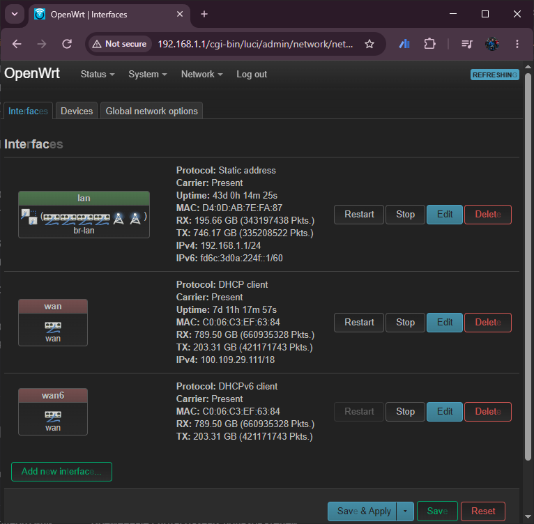
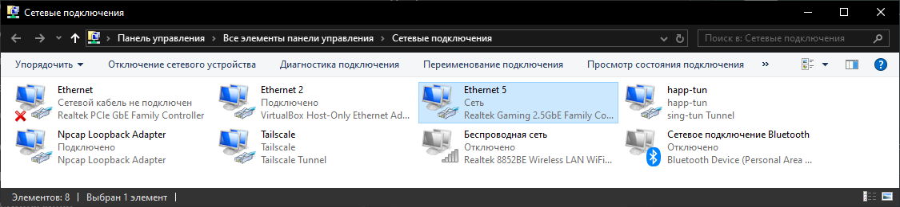

В [предыдущей теме](05-network-node.qmd) мы рассмотрели коммутацию пакетов: узел принимает блок, выбирает выход и передаёт его дальше. Теперь разберём, какие сведения позволяют сделать этот выбор при доставке через несколько сетей.

На примере IP (Internet Protocol, межсетевой протокол) рассмотрим задачу сетевого уровня. Начнём с одной схемы устройств A, D, R1, R2 и B; её состав и адреса будут сохраняться в первых эпизодах.

## Где заканчивается одна сеть и начинается другая? {#local-global}

На рисунке заданы три локальные области. Внутри каждой области возможна канальная доставка кадра между её участниками. Точки доступа и коммутаторы, обеспечивающие такой обмен, отдельно не показаны. R1 и R2 -- маршрутизаторы, соединяющие эти области.

::: {.column-page .course-visual}

:::

> A отправляет данные D, а затем B. В каком случае получатель находится в той же области? Где потребуется передать пакет из одной области в другую? Почему два участка Ethernet показаны как разные сети?

<details><summary>Разбор: границы локальной доставки</summary>

D находится с A в одной локальной сети. Для B нужно пройти через R1 и R2. В этой учебной конфигурации каждой локальной области назначена отдельная **IP-подсеть**: группа подключений, между которыми возможна непосредственная канальная доставка без IP-пересылки промежуточным маршрутизатором. Принадлежность к ней задаётся подключением и настройкой адресов.

Граница подсети не определяется материалом кабеля или названием канальной технологии. Между двумя Ethernet-сетями тоже может стоять маршрутизатор. Коммутатор внутри локальной области сам по себе не создаёт новую IP-подсеть. **Сетевой уровень** обеспечивает доставку между такими связанными сетями; успешной локальной передачи для этого недостаточно.

</details>

## Что означает интерфейс в домашнем роутере? {#home-router}

**Сетевой интерфейс** -- точка, через которую операционная система передаёт и принимает сетевые данные. Сначала рассмотрим интерфейсы домашнего роутера.

На странице настройки роутера OpenWrt показаны строки `lan`, `wan` и `wan6`. LAN (Local Area Network) -- локальная сеть, WAN (Wide Area Network) -- внешняя сеть; здесь это домашняя сторона и сторона подключения к провайдеру. У каждой строки есть имя используемого сетевого устройства и параметры протокола.

<figure class="course-demo ip-screenshot">

<figcaption>Интерфейсы домашнего роутера.</figcaption>
</figure>

| Строка OpenWrt | Устройство под ней | Что видно в настройке |
| --- | --- | --- |
| `lan` | `br-lan` | Статически задан IPv4-адрес `192.168.1.1`; показан также адрес IPv6 |
| `wan` | `wan` | Настроено получение IPv4-параметров от внешней сети |
| `wan6` | То же `wan` | Настроено получение IPv6-параметров на том же устройстве |

IPv4 и IPv6 -- версии 4 и 6 протокола IP. Здесь достаточно различать сторону подключения и её настройки; запись адресов и префиксов разберём ниже.

> Означают ли три строки три разъёма? Если у роутера несколько домашних LAN-портов, обязательно ли у каждого свой IP-адрес? Почему у `wan` и `wan6` указано одно устройство?

<details><summary>Разбор: порт, мост и логическая настройка</summary>

В OpenWrt строка **логического интерфейса** объединяет настройки сетевого обмена и связывает их с сетевым устройством. Поэтому `lan` и `br-lan` -- разные имена: первое относится к настройке, второе -- к устройству-мосту. **Мост** объединяет свои подключения для канального обмена. Несколько LAN-портов, а при соответствующей настройке и Wi-Fi, могут входить в одну домашнюю сеть; отдельный IP-адрес роутера для каждого такого порта не требуется. Точный состав моста по этой странице не установлен.

Адрес `192.168.1.1` относится к домашней стороне роутера, работающей через `br-lan`. У внешней стороны свои параметры. Строки `wan` и `wan6` показывают раздельные настройки IPv4 и IPv6 на одном устройстве `wan`; это не два дополнительных физических порта. Физический разъём, сетевое устройство и строка настройки логического интерфейса могут не соответствовать друг другу один к одному.

</details>

## Аппаратный или виртуальный интерфейс ПК? {#pc-interfaces}

На компьютере сетевой интерфейс может быть **аппаратным (физическим)** -- связанным с сетевым адаптером для обмена по кабелю или радио -- либо **виртуальным** -- созданным программно. Окно «Сетевые подключения» Windows показывает оба типа в одном списке.

<figure class="course-demo ip-screenshot">

<figcaption>Аппаратные и виртуальные интерфейсы ПК.</figcaption>
</figure>

> Почему восемь записей не означают восемь разъёмов?

<details><summary>Разбор: аппаратный и виртуальный интерфейс</summary>

| Тип интерфейса | Примеры на снимке | С чем связан |
| --- | --- | --- |
| **Аппаратный (физический)** | `Ethernet`, `Ethernet 5`, `Беспроводная сеть`, сетевое подключение Bluetooth | Сетевой адаптер, обеспечивающий обмен по кабелю или радио |
| **Виртуальный** | `Ethernet 2` (VirtualBox Host-Only), `Tailscale`, `happ-tun`, `Npcap Loopback Adapter` | Программный механизм обмена: виртуальная сеть, туннель или локальный обмен |

У виртуального интерфейса нет собственного отдельного разъёма. Для операционной системы это тоже точка сетевого обмена, поэтому аппаратные и программные интерфейсы отображаются в общем списке.

</details>

## Как один маршрутизатор подключён к двум сетям? {#interfaces}

На рисунке точки на границе значка маршрутизатора обозначают его подключения к сетям. Имена выходов условны: у R1 это `ifA` и `if12`, у R2 -- `if21` и `ifB`. В отличие от полного списка Windows или OpenWrt, здесь показаны только подключения, участвующие в рассматриваемом пути.

::: {.column-page .course-visual}

:::

> Через какой интерфейс R1 принимает данные от A? Через какой отправляет их к R2? Какие два интерфейса принадлежат разным маршрутизаторам, но подключены к одной сети?

<details><summary>Разбор: узел и его подключения</summary>

R1 принимает кадр от A через `ifA`, а к R2 передаёт через `if12`. На другом конце сети 2 находится интерфейс `if21` маршрутизатора R2. Интерфейсы R1.`if12` и R2.`if21` -- соседи в одной сети; два интерфейса самого R1 принадлежат разным сетям.

Выбор выхода -- выбор конкретного подключения. Маршрутизатор должен поддерживать канальный обмен своей входной и выходной сетей. Число интерфейсов не ограничено двумя; здесь оставлены только подключения, необходимые для пути A → B.

</details>

## Что именно получает IP-адрес? {#addresses}

Назначим каждому показанному интерфейсу один адрес IPv4 -- версии 4 протокола IP. Адрес записывается четырьмя десятичными числами от 0 до 255. Каждое число представляет 8 бит -- один октет; полный адрес занимает 32 бита. Все адреса здесь учебные.

::: {.column-page .course-visual}

:::

> Сколько адресов показано у R1? Какой из них доступен A в его собственной сети? Какой адрес R2 является соседом R1? Можно ли указать «адрес R1», не уточняя подключение?

<details><summary>Разбор: адрес интерфейса</summary>

У R1 на схеме два адреса: `192.0.2.129` на `ifA` и `192.0.2.1` на `if12`. Узел A находится в одной сети с первым интерфейсом. Для связи R1 с R2 используется другая сеть: адреса `192.0.2.1` и `192.0.2.2`.

**IP-адрес** обозначает источник или назначение сетевого пакета; в рассматриваемом одноадресном обмене он назначен интерфейсу. Устройство может иметь несколько интерфейсов, а интерфейс -- несколько адресов. Это не постоянный номер корпуса устройства. Для пакета A → B источник -- `192.0.2.130`, конечное назначение -- `198.51.100.20`.

</details>

## Кому A передаст первый кадр? {#first-hop}

A настроен для работы в сети 1. Его **шлюз по умолчанию** -- интерфейс R1 с адресом `192.0.2.129`. Шлюз -- маршрутизатор, которому узел может передать пакет для продолжения пути. В этом примере у A одна локальная сеть и один такой выход.

| Получатель | IP-адрес | Где подключён |
| --- | --- | --- |
| D | `192.0.2.131` | Сеть 1, вместе с A |
| B | `198.51.100.20` | Сеть 3, за R1 и R2 |

> Кому A адресует локальную передачу для D? А для B? Какой адрес останется конечным назначением IP-пакета во втором случае? Сможет ли A использовать шлюз, который находится только в сети 3?

<details><summary>Разбор: получатель и первый сосед</summary>

Для D узел A передаёт кадр непосредственно в своей сети. Для B он передаёт кадр интерфейсу R1 `192.0.2.129`, сохраняя в IP-пакете назначение B -- `198.51.100.20`. **Следующий узел (next hop)** и конечный получатель могут различаться. Шлюз первого перехода должен быть достижим в локальной сети A.

Принадлежность D и B к сетям пока задана рисунком и таблицей. Ниже разберём, как A проверяет её по собственным настройкам и адресу назначения. Для локальной передачи нужны и канальные адреса; сопоставление IP-адреса соседа с канальным адресом здесь считаем уже выполненным. Узел A не обязан знать все последующие маршрутизаторы.

</details>

## По каким сведениям R1 продолжит путь? {#directions}

Пакет к B принят на R1. Из подключений R1 известны сети 1 и 2. Администратор также задал направление к сети B через соседа R2. Ниже показаны две записи для конкретных получателей; способ записи целых сетей разберём следующим шагом.

| Назначение пакета | Следующий получатель кадра | Выход R1 |
| --- | --- | --- |
| D · `192.0.2.131` | Сам D, в подключённой сети 1 | `ifA` |
| B · `198.51.100.20` | R2 · `192.0.2.2`, в сети 2 | `if12` |

> Какую запись R1 применит к пакету для B? Почему следующим адресом указан именно `192.0.2.2`, а не другой интерфейс R2 -- `198.51.100.1`? Нужно ли заменять адрес B внутри пакета адресом R2?

<details><summary>Разбор: решение R1</summary>

R1 читает конечное IP-назначение `198.51.100.20` и выбирает выход `if12`. Кадр на этом выходе передаётся соседнему интерфейсу R2 `192.0.2.2`: он подключён к той же сети 2. Другой адрес R2 относится к сети 3, в которой у R1 нет интерфейса.

В IP-пакете остаётся адрес B. Это **пересылка (forwarding)** -- применение таблицы к конкретному пакету. **Маршрутизация (routing)** -- получение и выбор сведений для построения таблиц. Здесь направления заданы заранее: непосредственно подключённые сети известны из настройки интерфейсов, удалённое направление добавлено администратором. Протоколы автоматического обмена маршрутами -- отдельная задача.

</details>

## Почему R2 может передать пакет самому B? {#last-hop}

R2 принял пакет через `if21`. Его интерфейс `ifB` с адресом `198.51.100.1` подключён к той же сети 3, что и B.

| Назначение пакета | Следующий получатель кадра | Выход R2 |
| --- | --- | --- |
| B · `198.51.100.20` | Сам B, в подключённой сети 3 | `ifB` |

> Нужен ли здесь ещё один маршрутизатор? Чем запись R2 отличается от записи R1 для того же B? Где закончится межсетевой путь?

<details><summary>Разбор: последний переход</summary>

R2 передаёт пакет непосредственно B через `ifB`. У R1 следующим узлом был маршрутизатор R2; у R2 следующим узлом является конечный получатель B. Оба выбирают выход по одному и тому же IP-назначению, но используют собственные таблицы и собственные подключения.

Путь A → R1 → R2 → B складывается из трёх локальных передач. Полный список будущих переходов не хранится в каждой записи таблицы. Если одному из узлов неизвестно продолжение пути, предыдущее успешное решение этого не исправит.

</details>

## Какая оболочка меняется на каждом участке? {#encapsulation}

Во [вводной теме](00-introduction.qmd#layers) инкапсуляция связывала данные приложения, сетевой пакет и кадр. Сопоставим оболочки для уже разобранного пути A → B. Преобразования адресов и фрагментации в примере нет.

::: {.column-page .course-visual}
<div class="course-demo ip-frames" role="group" aria-label="Один IP-пакет и три локальные передачи">
<div class="ip-frame"><strong>Кадр Wi-Fi · A → R1</strong><span>Сосед: интерфейс R1 192.0.2.129</span><div class="ip-packet"><strong>IP-пакет</strong><span>Источник: 192.0.2.130 (A)</span><span>Назначение: 198.51.100.20 (B)</span><span>Данные: «Сообщение»</span></div></div>
<div class="ip-frame"><strong>Кадр Ethernet · R1 → R2</strong><span>Сосед: интерфейс R2 192.0.2.2</span><div class="ip-packet"><strong>IP-пакет</strong><span>Источник: 192.0.2.130 (A)</span><span>Назначение: 198.51.100.20 (B)</span><span>Данные: «Сообщение»</span></div></div>
<div class="ip-frame"><strong>Кадр Ethernet · R2 → B</strong><span>Сосед: интерфейс B 198.51.100.20</span><div class="ip-packet"><strong>IP-пакет</strong><span>Источник: 192.0.2.130 (A)</span><span>Назначение: 198.51.100.20 (B)</span><span>Данные: «Сообщение»</span></div></div>
</div>
:::

> Какие сведения относятся ко всему пути, а какие -- к одному участку? Передаёт ли R1 принятый кадр без изменений? Что произойдёт с оболочкой между двумя сетями Ethernet?

<details><summary>Разбор: пакет внутри кадра</summary>

Сетевой пакет IP называют **датаграммой**. В нашем примере сохраняются IP-источник, IP-назначение и данные. Маршрутизатор снимает входную канальную оболочку, обрабатывает пакет и создаёт новый кадр для выбранного выхода. Служебные поля самого IP-заголовка тоже могут изменяться; их рассмотрим при разборе ограничения длины пути.

Кадр заканчивается на границе своего участка даже тогда, когда с обеих сторон используется Ethernet. Локальная доставка опирается на канальные адреса, например MAC-адреса (Media Access Control, управление доступом к среде) в Ethernet. IP-адрес следующего соседа помогает определить локального получателя; он не является заменой канальному адресу в заголовке кадра.

</details>

## Можно ли объединить адреса одного направления? {#address-groups}

При настройке каждой сети выделен свой блок адресов. Интерфейсам назначены адреса из соответствующего блока. Для сети 3 в таблице R1 задано направление через R2; добавление туда получателей `198.51.100.21` и `198.51.100.22` не меняет это направление.

| Сеть на рисунке | Выделенный блок | Показанные интерфейсы |
| --- | --- | --- |
| 1 | `192.0.2.128–192.0.2.191` | A, D, R1.`ifA` |
| 2 | `192.0.2.0–192.0.2.3` | R1.`if12`, R2.`if21` |
| 3 | `198.51.100.0–198.51.100.255` | R2.`ifB`, B |

<div class="course-demo ip-address-groups" role="group" aria-label="Адреса одного направления имеют одинаковые первые три октета">
<div><code><span class="ip-prefix-part">198.51.100.</span><span>20</span></code> → R2</div>
<div><code><span class="ip-prefix-part">198.51.100.</span><span>21</span></code> → R2</div>
<div><code><span class="ip-prefix-part">198.51.100.</span><span>22</span></code> → R2</div>
<p>Рамкой выделена одинаковая часть адресов. Вся группа: <code>198.51.100.0–198.51.100.255</code>.</p>
</div>

> Чем похожи эти адреса? Как заменить множество строк одной записью, сохранив направление? Достаточно ли совпадения начала адресов без сведений о том, куда их пересылать?

<details><summary>Разбор: запись для группы</summary>

Для назначения адресов заранее выделены блоки; это позволяет описывать сеть общим началом адресов. На R1 вместо отдельных строк для B и остальных получателей сети 3 можно хранить одну: «блок сети 3 -- через R2, выход if12». На R2 тот же блок означает непосредственно подключённую сеть и выход ifB.

Общая часть адреса полезна вместе со сведениями о подключениях и направлениях. Одна лишь похожая запись адресов не доказывает достижимость. Кроме того, выделенный блок включает специальные адреса: все его значения нельзя автоматически считать адресами отдельных устройств.

</details>

## Как записать границу группы адресов? {#prefixes}

У IPv4 адрес занимает 32 бита: четыре октета по 8 бит. Чтобы описать предыдущую группу, нужно зафиксировать первые три октета, то есть 24 бита. Запись `198.51.100.0/24` задаёт это общее начало и его длину; остальные 8 бит могут различаться. Фиксированное начало -- **сетевой префикс**. Такая запись используется в бесклассовой адресации CIDR (Classless Inter-Domain Routing).

<div class="course-demo ip-prefix-example">
<div><code><span class="ip-prefix-part">198.51.100</span><span>.20</span></code></div>
<p>24 фиксированных бита | 8 изменяющихся битов</p>
<p>Запись группы: <code>198.51.100.0/24</code> → R2</p>
</div>

> Попадёт ли `198.51.100.200` в эту группу? А `198.51.101.20`? Сколько вариантов даёт изменяющаяся часть из 8 бит?

<details><summary>Разбор: длина префикса</summary>

Адрес `198.51.100.200` входит в группу: первые 24 бита совпадают. У `198.51.101.20` отличается третий октет, поэтому он не входит. Восемь изменяющихся битов дают $2^8=256$ адресов. Одна строка таблицы может описывать весь этот блок.

</details>

### Если граница проходит внутри октета

Вернёмся к сети 1: ей выделен меньший блок `192.0.2.128–192.0.2.191`. Его граница не совпадает с точкой в десятичной записи. Для адреса A `192.0.2.130` сравним два варианта фиксированного начала. В двоичной записи виден каждый из 32 битов:

```text
/24: 11000000 00000000 00000010 | 10000010
       24 фиксированных бита   | 8 изменяющихся
/26: 11000000 00000000 00000010 10 | 000010
       26 фиксированных битов     | 6 изменяющихся
```

> Какой префикс `/24` содержит адрес A? А `/26`? Какой из них описывает именно заданный блок сети 1? Сколько адресов задаёт каждый?

<details><summary>Разбор: группа адресов и размер блока</summary>

Для `/24` получаем `192.0.2.0/24`, диапазон `192.0.2.0–192.0.2.255`: $2^{32-24}=256$ адресов. Он охватывает больше, чем выделено сети 1. Для `/26` фиксированы ещё два старших бита последнего октета: `10|000010`. Получаем `192.0.2.128/26`, диапазон `192.0.2.128–192.0.2.191`: $2^{32-26}=64$ адреса. Он соответствует заданному блоку.

В общем случае блок IPv4 `/p` содержит $2^{32-p}$ адресов. Это размер блока, а не автоматически число доступных узлов: в обычной подсети часть адресов имеет специальное назначение. Более длинный префикс задаёт меньшую, более конкретную группу. Объединение адресов сокращает таблицы и объём обновлений, когда у группы одно направление; отдельные адресные маршруты тоже возможны.

</details>

### Зачем нужна маска?

Ту же границу можно задать 32-битной **маской**: единицы отмечают фиксированные биты префикса, нули -- оставшиеся. Ниже два способа записать уже рассмотренную границу, а не два разных правила выбора направления.

```text
/24: 11111111 11111111 11111111 00000000 = 255.255.255.0
/26: 11111111 11111111 11111111 11000000 = 255.255.255.192
```

> Какие биты адреса A `192.0.2.130` нужно оставить при маске `/26`? Что получится, если остальные заменить нулями?

<details><summary>Разбор: маска и адрес сети</summary>

В последнем октете `10000010` оставляем первые два бита и обнуляем остальные: `10000000`, то есть 128. Получаем адрес сети `192.0.2.128`, а группу записываем `192.0.2.128/26`. Это побитовое И адреса и маски. Маска не хранится в поле адреса назначения обычной IP-датаграммы: граница нужна для описания сетей и записей таблицы.

</details>

## Как A узнаёт свою сеть по числам? {#on-link}

Теперь запишем настройку A полностью: адрес `192.0.2.130/26`, маска `255.255.255.192`, шлюз `192.0.2.129`. В этом примере A имеет одну подключённую сеть и маршрут по умолчанию через R1. Для проверки локальной принадлежности он применяет **свою маску** к собственному адресу и к адресу назначения.

> Совпадут ли результаты для A и D (`192.0.2.131`)? А для A и B (`198.51.100.20`)? Попадает ли адрес шлюза в локальную сеть A?

<details><summary>Разбор: проверка первого перехода</summary>

| Адрес | Результат применения маски A `/26` |
| --- | --- |
| A · `192.0.2.130` | `192.0.2.128` |
| D · `192.0.2.131` | `192.0.2.128` |
| B · `198.51.100.20` | `198.51.100.0` |
| Шлюз R1 · `192.0.2.129` | `192.0.2.128` |

D и шлюз находятся в локальной сети A. B -- за её пределами, поэтому A использует маршрут через R1. Применение маски A к адресу B проверяет только принадлежность сети A; оно не определяет настоящую маску сети B. Ошибочная настройка A, например слишком короткий префикс, может привести к неверному решению о локальной доставке.

</details>

## Какую строку выберет маршрутизатор? {#forwarding}

Расширим знакомую сеть: у R1 появился третий выход `if13` к R3, а за R3 -- получатель C. Есть также связь R3 с R2. В таблице R1 одновременно заданы конкретный блок сети B, более общий блок и маршрут на все остальные случаи. Рассматриваем решение R1; наличие строки ещё не доказывает достижимость всех адресов после следующего узла.

::: {.column-page .course-visual}

:::

<div class="ip-scroll" tabindex="0" role="region" aria-label="Данные для выбора маршрута">

| Префикс | IP следующего узла | Выходной интерфейс |
| --- | --- | --- |
| `198.51.0.0/16` | `192.0.2.2` (R2) | if12 |
| `198.51.100.0/24` | `192.0.2.2` (R2) | if12 |
| `0.0.0.0/0` | `192.0.2.6` (R3) | if13 |

</div>

> Какие строки подходят для B (`198.51.100.20`)? Какая задаёт наименьшую группу? Что выберет R1 для `198.51.101.20` и для C (`203.0.113.20`)?

<details><summary>Разбор: выбор по префиксу</summary>

Для B совпадают все три строки; выбирается `/24`. Это **правило самого длинного совпадающего префикса (longest prefix match)**. Для `198.51.101.20` выбирается `/16`, для C -- `/0`. Порядок строк не определяет выбор. При нескольких равных префиксах нужны дополнительные правила; здесь такого случая нет.

**Маршрут по умолчанию** `0.0.0.0/0` совпадает с любым IPv4-адресом, но уступает любому более длинному совпавшему префиксу. Если нет ни подходящей записи, ни default route, пакет переслать нельзя. Запись для непосредственно подключённой сети указывает выход к конечному узлу: next hop тогда сам адрес назначения.

</details>

## Что остановит пакет в цикле? {#ttl}

Из-за ошибочных таблиц возник путь `R1 → R2 → R3 → R1`. Все канальные участки исправны. В заголовке IPv4 есть поле TTL (Time to Live) -- ограничение времени жизни пакета; на каждом переходе его значение уменьшается.

> Что произойдёт без ограничения числа пересылок? Если пакет пришёл на R1 с TTL 2, сможет ли он пройти два маршрутизатора и попасть в сеть после них?

<details><summary>Разбор: ограничение жизни пакета</summary>

Перед пересылкой маршрутизатор уменьшает TTL IPv4 как минимум на единицу. В обычном рассмотрении переходов: `64 → 63 → 62`. При исчерпании лимита пакет отбрасывается. При TTL 2 первый маршрутизатор отправит пакет с TTL 1; следующий уже не сможет переслать его дальше. Для $N$ пересылок при уменьшении на единицу нужен начальный TTL больше $N$.

Название TTL исторически связано со временем жизни; при разборе пути это прежде всего ограничитель числа переходов, а не измеритель задержки в секундах. Об ошибке может сообщить протокол управляющих сообщений ICMP (Internet Control Message Protocol), но такое сообщение не гарантирует доставку исходного пакета и само может потеряться.

</details>

## Путешествие датаграммы {#journey}

В сети есть ветви `R1 → R2 → B` и `R1 → R3 → C`, а также связь `R3 → R2`. A уже отправил пакет на R1 через Wi-Fi. Адрес B -- `198.51.100.20`, C -- `203.0.113.20`; адрес `192.0.2.200` в этой сети недостижим. Преобразования адресов нет. За один шаг рассматривается одна пересылка маршрутизатором.

> Какую запись выберет каждый узел? Что изменится при наличии только default route на R1? Что покажут таблицы без маршрута или с циклом?

::: {.column-page .course-interactive}
<div class="course-demo" data-ip-journey>
<p>Статический пример: A → R1 → R2 → B. На R1 для 198.51.100.20 совпадают /0, /16 и /24; выбран 198.51.100.0/24, next hop 192.0.2.2, выход if12. На R2 выбрана непосредственно подключённая 198.51.100.0/24, выход ifB, next hop -- сам B.</p>
<p>Wi-Fi [IP: A → B, TTL 64] → R1 → Ethernet по меди [IP: A → B, TTL 63] → R2 → Ethernet по волокну [IP: A → B, TTL 62]. Источник 192.0.2.130 и назначение 198.51.100.20 сохраняются. Для выбора предположений нужен JavaScript.</p>
</div>
:::

<details><summary>Разбор: варианты пути</summary>

В обычной сети B достигается через R1 и R2: на R1 `/24` выигрывает у `/16` и `/0`. С единственной записью по умолчанию R1 отправит пакет на R3, а тот -- на R2; до B будет три пересылки. Наличие default route не доказывает доставку: для `192.0.2.200` на R3 не окажется продолжения.

В наборе без общего маршрута R1 знает только сеть B: пакет к C будет отброшен уже там. В наборе с циклом пакет к B ходит между R1 и R2, пока не исчерпается TTL. Новый кадр создаётся только при успешной пересылке; выбор IP-маршрута не отменяет необходимость локальной доставки на каждом выходе.

</details>

## Какие задачи объясняют поля заголовка? {#headers}

Получатель должен отличить версию протокола, границы пакета и его назначение. После снятия IP-заголовка нужно понять, кому передать содержимое. Ниже одна строка занимает 32 бита; адрес IPv6 занимает четыре таких строки. Ширина поля соответствует числу битов.



> Какие поля нужны для уже разобранной пересылки? Как различить длину заголовка и длину всей датаграммы? Почему при изменении TTL нельзя оставить прежнюю контрольную сумму IPv4?

<details><summary>Разбор: поля как ответы на задачи</summary>

**Version** выбирает формат IP. В IPv4 **IHL (Internet Header Length)** задаёт длину заголовка в 32-битных словах, **Total Length** -- всей датаграммы в байтах. **Source Address** и **Destination Address** задают источник и назначение; **TTL** ограничивает жизнь пакета. **Protocol** указывает протокол содержимого, а не следующий маршрутизатор. **Header Checksum** проверяет только заголовок и обновляется при изменении TTL; полезную нагрузку она не защищает.

**IPv6**, версия 6 IP, решает ту же задачу межсетевой доставки. Базовый заголовок фиксирован: 40 байт, адреса по 128 бит. В IPv4 без опций заголовок 20 байт; с опциями его длина переменна. В IPv6 **Payload Length** считает байты после базового заголовка; **Hop Limit** уменьшается на единицу каждым пересылающим узлом, **Next Header** указывает следующий заголовок -- расширение либо протокол содержимого. Контрольной суммы базового заголовка IPv6 нет.

</details>

<details><summary>Справка: остальные поля и размер участка</summary>

В схемах DSCP (Differentiated Services Code Point) обозначает класс обслуживания, ECN (Explicit Congestion Notification) -- явное уведомление о перегрузке; в IPv6 они входят в Traffic Class. Flow Label -- метка потока. Эти поля сами по себе не обеспечивают гарантии качества.

Identification, Flags и Fragment Offset IPv4 связаны с фрагментацией. Если датаграмма не помещается в максимальную единицу передачи MTU (Maximum Transmission Unit) следующего участка, IPv4-маршрутизатор может фрагментировать её, когда это разрешено флагами. В IPv6 маршрутизаторы не фрагментируют пакет: при необходимости фрагменты создаёт источник, используя дополнительный заголовок. Заголовки расширения (extension headers) следуют за базовым IPv6-заголовком. Сборку фрагментов выполняет конечный получатель.

Options и Padding IPv4 -- дополнительные параметры и выравнивание. Полный разбор этих механизмов не нужен для выбора next hop. В основном примере пакеты помещаются в MTU всех участков.

</details>

## Как прочитать адрес IPv6? {#ipv6}

Адрес `2001:db8:0:1:0:0:0:20` состоит из восьми 16-битных групп, записанных шестнадцатерично. Ведущие нули группы можно опускать; одну последовательность нулевых групп -- заменить на `::`. Поэтому тот же адрес записывается `2001:db8:0:1::20`.

<div class="ip-scroll" tabindex="0" role="region" aria-label="Данные для выбора маршрута">

| Префикс | Next hop | Выход |
| --- | --- | --- |
| `2001:db8::/32` | `2001:db8:12::2` | if12 |
| `2001:db8:0:1::/64` | Сам адрес назначения | ifB |
| `::/0` | `2001:db8:13::3` | if13 |

</div>

> Какую строку выберет маршрутизатор для `2001:db8:0:1::20`? Изменится ли принцип пересылки при замене IPv4 на IPv6?

<details><summary>Разбор: общая модель двух версий</summary>

Совпадают `/32`, `/64` и `/0`; выбирается `/64`. Это непосредственно подключённая сеть назначения. В IPv6 префикс тоже означает фиксированные начальные биты, а `::/0` -- маршрут по умолчанию. Сетевой префикс обозначает группу адресов; полный адрес -- конкретное назначение внутри неё.

При движении обычного пакета без преобразований адреса сохраняются, канальные кадры создаются на каждом участке заново, Hop Limit уменьшается. Увеличение адреса и изменение заголовка не отменяют выбора next hop по самому длинному совпавшему префиксу. IP включает обе версии и не является синонимом IPv4.

</details>

### Сколько места занимает заголовок?

После IP-заголовка передаётся 100 байт, включая все данные верхних уровней. В IPv4 нет опций, в IPv6 -- расширений. Канальную оболочку пока не учитываем.

> Какова доля IP-заголовка в полной длине датаграммы для каждой версии? Доказывает ли результат, что одна версия всегда эффективнее?

<details><summary>Разбор: интерпретация служебных затрат</summary>

IPv4: $20/(20+100)\approx16{,}7\%$. IPv6: $40/(40+100)\approx28{,}6\%$. Это доля заголовка в данном пакете, а не отношение к полезной нагрузке. При большей нагрузке доля уменьшается. Больший базовый заголовок IPv6 оплачивает в том числе более длинные адреса; сравнение одного короткого пакета не оценивает эффективность всей системы.

</details>

## Если маршрут найден, доставка гарантирована? {#best-effort}

На выход R2 приходят пакеты быстрее, чем он успевает передавать. Буфер конечен -- как в [опыте с очередью в предыдущей теме](05-network-node.qmd#packets).

> Пакет потерян при переполнении исправного узла. Нарушил ли IP свои обещания? Должны ли две последовательные датаграммы прийти с одинаковой задержкой и в том же порядке?

<details><summary>Разбор: границы службы IP</summary>

**Доставка по возможности (best effort)** означает пересылку при имеющихся маршрутах и ресурсах без гарантии доставки, порядка, отсутствия дубликатов или фиксированной задержки. Разные очереди и изменения пути могут менять задержку и порядок; исчерпание буфера или TTL приводит к потере. IP не выполняет обязательную повторную передачу потерянной датаграммы.

Это свойство службы межсетевой доставки, а не утверждение о плохой физической среде. Даже безошибочные участки не устраняют перегрузку общего выхода. Надёжность, когда она нужна приложению, требует дополнительных механизмов поверх этой службы.

</details>

## Полный путь в незнакомой сети {#transfer}

У A адрес `192.0.2.130`, у B -- `198.51.100.20`. Используется набор таблиц с единственным default route на R1: `A → R1 → R3 → R2 → B`. Первый участок -- Wi-Fi, следующие -- Ethernet по волокну, Ethernet по меди и Ethernet по волокну. Начальный TTL равен 4. Адреса не преобразуются.

> Для каждого маршрутизатора: каковы назначение, выбранный префикс, next hop, выход и TTL? Какой кадр принят, какой создан? Достаточно ли TTL? Что останется задачей IP, если заменить один Ethernet-участок другой канальной технологией?

<details><summary>Разбор: четыре участка, три решения</summary>

<div class="ip-scroll" tabindex="0" role="region" aria-label="Данные для выбора маршрута">

| Узел | Выбранный префикс | Next hop | Выход | TTL до → после |
| --- | --- | --- | --- | --- |
| R1 | `0.0.0.0/0` | `192.0.2.6` (R3) | if13 | 4 → 3 |
| R3 | `198.51.100.0/24` | `192.0.2.9` (R2) | if32 | 3 → 2 |
| R2 | `198.51.100.0/24` | `198.51.100.20` (B) | ifB | 2 → 1 |

</div>

B получит пакет с TTL 1: конечный узел уже не пересылает его дальше. При начальном TTL 3 пакет был бы отброшен на R2. На всех участках IP-назначение -- B, источник -- A; next hop меняется. Каждый входной кадр заканчивается на соответствующем маршрутизаторе. Заголовок IPv4 обновляется, полезная нагрузка сохраняется.

При замене канальной технологии маршрутизатору нужны поддерживающие её интерфейс и локальные правила передачи кадра. Функция IP -- адресация и выбор следующего участка -- сохраняется. Если выходная технология имеет меньшую MTU, размер пакета потребует отдельного решения.

</details>

<details><summary>Справка: домашний IPv4 и преобразование адресов</summary>

В домашней сети часто применяется преобразование сетевых адресов NAT (Network Address Translation). Оно может менять IP-адреса, а некоторые разновидности -- и транспортные порты. Это дополнительная функция пограничного узла, не обязательный шаг IP-пересылки. Поэтому вывод о сохранении источника здесь сделан для явно заданной сети без NAT.

</details>

::: {.callout-note icon=false appearance="simple"}
## 🚀 Что дальше?

<div class="ip-topology" role="img" aria-label="Из трёх отправленных датаграмм получатель увидел первую и третью, вторая потеряна">Источник: ① ② ③ → сеть и очереди → получатель: ① · ③</div>

Мы проследили межсетевую доставку переход за переходом. Если приложению нужны все данные и правильный порядок, какие дополнительные действия потребуются источнику и получателю?

[Следующая тема: Транспортный уровень: от хоста к приложению →](07-transport-layer.qmd)

:::

<script type="module" src="../interactives/ip-journey-ui.js"></script>
<script src="../interactives/image-lightbox.js" defer></script>
