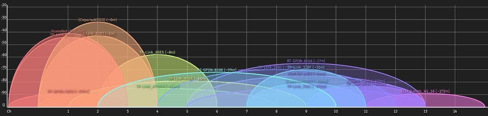

В [теме о физическом ресурсе](04-physical-resource.qmd) мы выяснили, как разделить его между потоками и участниками. В [предыдущей теме](channel-playground.qmd) -- как меняется сигнал при распространении. Теперь **пользовательский терминал** включается рядом с уже работающей **точкой доступа**, которая обслуживает несколько терминалов. Новый терминал хочет передать пользовательские данные через тот же общий ресурс.

Рассматриваем точку доступа с периодическими общими сообщениями, случайным первым обращением и назначением ресурса. Это учебный сценарий: в других системах функции могут совмещаться, повторяться или выполняться в другом порядке.

> Что должно произойти, прежде чем терминал сможет участвовать в обмене данными?

<details><summary>Результат обсуждения: что ещё требуется для обмена</summary>

Физическая возможность передавать сигнал ещё не даёт возможности участвовать в общем обмене: нужны согласованные координаты приёма, правила и доступ к ресурсу.

</details>

## Где искать передачу точки доступа? {#discovery}

Терминал только включился. Рядом могут работать несколько точек доступа, причём на разных частотных каналах.

> Как терминал узнаёт, на какой частоте вообще искать передачу?
>
> Что должно быть известно терминалу для начала работы?

<div class="course-demo ta-demo" data-agreement-timeline data-timeline-stage="0" data-timeline-current></div>

:::::: {.course-pair .course-pair-visual}
::::: {.course-pair-grid}
:::: {}

```{=html}
<figure class="course-demo fs-reference">
  <div>
    <a href="../assets/transmission-agreement/wifi-scan.png" target="_blank" rel="noopener" aria-label="Открыть снимок сканирования Wi-Fi в исходном размере"></a>
  </div>
  <figcaption>Результаты сканирования Wi-Fi.</figcaption>
</figure>
```

::::
:::: {}

<details><summary>Разбор: поиск передачи</summary>

Поиск ограничивают заранее известные **диапазоны**, **частотные положения** и **признаки передачи**, заданные стандартом, оборудованием и конфигурацией. Терминал проверяет кандидатов, а не весь электромагнитный спектр. Проверка может быть пассивной или активной, последовательной или параллельной.

</details>

::::
:::::
::::::

### Есть ли передача в выбранной полосе? {#frequency-search}

В диапазоне 2,4 ГГц могут работать Wi-Fi (IEEE 802.11), Bluetooth, ANT/ANT+ и системы IEEE 802.15.4, включая Zigbee. Одного выбора диапазона недостаточно для определения системы.

> Как отличить наличие энергии в полосе от наличия передачи нужной точки доступа?




### Наша ли это система? {#system-recognition}

Частотный ресурс выбран, энергия обнаружена. Но в этой полосе может работать другая система или источник помех.

> Какой известный признак позволил бы проверить, что передача принадлежит нашей системе? Зачем наблюдать его повторно?

<details><summary>Разбор: распознавание системы</summary>

Нужен **заранее известный признак**: последовательность или структура, которую можно проверить. Повторное обнаружение в ожидаемые моменты помогает отличить устойчивую передачу от случайного совпадения. Более частая служебная опора сокращает ожидание, но занимает ресурс.

</details>

## Какие координаты приёма нужно согласовать? {#physical-synchronization}

Терминал обнаружил кандидата на точку доступа. Но момент включения терминала независим от работы точки доступа.

> Что необходимо согласовать, чтобы распознать нужный сигнал?


<div class="course-demo ta-demo" data-agreement-timeline data-timeline-stage="1" data-timeline-current></div>

<details><summary>Три вида согласования</summary>

**Тактовая синхронизация** восстанавливает частоту следования символов и моменты отсчёта.

**Кадровая (цикловая) синхронизация** находит начало физического кадра (цикла). Здесь речь о структуре физической передачи; [канальный кадр](#link-frame) разберём после организации доступа.

**Частотная синхронизация** помогает восстановить несущую частоту.

**Опорный генератор ≠ тактовый генератор.**

</details>

### Где начинается физический кадр? {#frame-start}

В опыте терминал уже различает символы и читает их значения. Точка доступа объединяет символы в физические кадры, но терминал подключился посреди передачи.

> Как отличить начало кадра от любой другой позиции?


При сравнении известной опоры с потоком одинаковые биты дают вклад +1, разные -- −1. В каждой позиции вклады складываются. Нижний график показывает результат для всех сдвигов, маркер -- начало сравниваемого участка. Значение $C$ нормировано энергией опоры; при шуме оно может выходить за пределы ±1.

### Преамбула из единиц: насколько точно можно найти начало?

В поток вставлена преамбула из 15 единиц. Синий сигнал -- принятый поток, оранжевый пунктир -- известная преамбула. ОСШ -- отношение сигнал/шум.

> Сильно ли отличается полное совпадение от сдвига на один бит? Как изменится различимость соседних положений при добавлении шума?

<div class="course-demo ta-demo" data-correlation-illustration="ones"></div>
<p class="interactive-source"><a href="https://github.com/temaSW/intro-to-networking/blob/main/course/interactives/transmission-agreement-ui.js">Исходник</a></p>

### Псевдослучайная последовательность: где совпадает весь рисунок?

**Псевдослучайная последовательность (ПСП)** воспроизводится по известному правилу и выглядит нерегулярно. Здесь опора также содержит 15 бит; окружающие данные те же, что в первом опыте. ПСП показана оранжевым пунктиром.

> Какой признак позволяет выбрать одно положение? Сохранится ли оно при сильном шуме?

<div class="course-demo ta-demo" data-correlation-illustration="bits"></div>
<p class="interactive-source"><a href="https://github.com/temaSW/intro-to-networking/blob/main/course/interactives/transmission-agreement-ui.js">Исходник</a></p>

<details><summary>Разбор: граница кадра</summary>

У цепочки единиц соседние положения сохраняют много совпадений, поэтому вершина широкая. У выбранной ПСП пик уже: положение опоры различается точнее. Сравнение по сдвигам называют **корреляционным поиском**, известную опору -- **синхропоследовательностью**.

Шум может сместить максимум. Для установления **кадровой синхронизации** нужны критерий обнаружения и проверка повторяемости; один высокий пик ещё не гарантирует верную границу.

</details>

<span id="symbol-time"></span>

### Как компенсировать частотное рассогласование? {#carrier-frequency}

Нужный участок спектра уже выбран, моменты отсчёта и границы кадра найдены. Но генераторы передатчика и приёмника имеют немного разные частоты. Поэтому после переноса сигнала в основную полосу остаётся **неизвестное частотное рассогласование** $\Delta f$. Его происхождение разобрано в [предыдущей теме](channel-playground.qmd#совпадает-ли-принятая-частота-с-переданной).

Без шума $r(t)=s(t)e^{j2\pi\Delta f t}$: $s(t)$ -- переданный сигнал, $r(t)$ -- принятый, $t$ -- время. На графике показаны принятые символы и известная передатчику и приёмнику опора.

> Созвездие вращается. Как узнать скорость вращения и компенсировать её, если данные неизвестны? Что изменится с шумом?

<div class="course-demo ta-demo" data-agreement="frequency"></div>
<p class="interactive-source"><a href="https://github.com/temaSW/intro-to-networking/blob/main/course/interactives/transmission-agreement-ui.js">Исходник</a></p>

<details><summary>Разбор: частотное рассогласование</summary>

Сопоставление с **известной опорой** убирает модуляцию данных и позволяет оценить скорость вращения $\widehat{\Delta f}$. Обратный поворот компенсирует её:

$$r_{\mathrm{corr}}(t)=r(t)e^{-j2\pi\widehat{\Delta f}t}.$$

Это **частотная синхронизация**: известная опора → оценка рассогласования → компенсация. Шум делает оценку неточной.

</details>

Частотное рассогласование скомпенсировано. Что ещё мешает восстановить символы, если канал меняет их амплитуду и фазу?

### Как узнать, что канал сделал с данными? {#channel-pilots}

Терминал уточнил время и частоту приёма. Но сигнал точки доступа по-прежнему проходит через неизвестный канал. Для наглядности возьмём один символ мультиплексирования с ортогональным частотным разделением (OFDM): данные распределены по поднесущим, и каждая может испытывать своё ослабление и поворот фазы. Участок спектра с провалом искажает одни символы сильнее других.

На поднесущей $k$ без шума $Y[k]=H[k]X[k]$: $X$ -- переданный символ, $Y$ -- принятый, $H$ -- комплексный коэффициент передачи канала. Канал в пределах этого символа считаем постоянным. Графики показывают модули значений; истинный $H$ дан для проверки и приёмнику неизвестен.

> Принятый символ слабый: таким его передали или его ослабил канал? Как узнать о провале между известными опорными символами?

<div class="course-demo ta-demo" data-agreement="pilots"></div>
<p class="interactive-source"><a href="https://github.com/temaSW/intro-to-networking/blob/main/course/interactives/transmission-agreement-ui.js">Исходник</a></p>

<details><summary>Разбор: оценка канала</summary>

На известных ненулевых символах -- **пилотах** -- можно оценить канал:

$$\widehat H[k_{\mathrm{п}}]=\frac{Y[k_{\mathrm{п}}]}{X[k_{\mathrm{п}}]},\qquad \widehat X[k]=\frac{Y[k]}{\widehat H[k]}.$$

Между пилотами оценку интерполируют. Компенсацию действия канала называют **эквализацией**. Редкие пилоты могут пропустить частотный провал; дополнительные занимают места данных. Деление на малую оценку $H$ усиливает шум, поэтому глубокий провал нельзя устранить одним знанием канала.

</details>

Теперь приёмник может компенсировать частотное рассогласование и оценённое действие канала. Но правильное восстановление символов ещё не сообщает, как интерпретировать параметры работающей системы.

## Как узнать, где и когда передавать? {#system-rules}

> Кто задаёт расписание? Откуда терминал узнаёт, когда и на какой частоте точка доступа будет его слушать?


<div class="course-demo ta-demo" data-agreement-timeline data-timeline-stage="2" data-timeline-current></div>

<details><summary>Результат обсуждения: правило и его параметры</summary>

Точка доступа **задаёт параметры**, затем передаёт их в служебном сообщении. Терминал знает формат заранее, читает значения и действует по ним. Общий формат сообщения и текущие параметры работающей системы -- разные сведения.

</details>

### Пример: что означает полученное сообщение? {#service-message}

Получено `010 100 00`. Формат известен: первое поле -- номер первого слота, второе -- период повторения, третье -- частотный ресурс. Один слот длится 1 мс; слот n начинается в n мс и заканчивается в n + 1 мс. Начало отсчёта известно из синхронизации.

> Какие значения сообщила точка доступа? Если терминал готов в t = 4 мс, когда он сможет обратиться?

```{=html}
<div class="course-demo service-fields" role="group" aria-label="Три поля восьмибитного служебного сообщения">
  <div><code>010</code><strong>O · первый слот</strong><span>3 бита · двоичное число</span></div>
  <div><code>100</code><strong>P · период</strong><span>3 бита · число слотов между началами приёма</span></div>
  <div><code>00</code><strong>R · ресурс</strong><span>2 бита · 00: A, 01: B, 10: C, 11: D</span></div>
</div>
```

<details><summary>Результат обсуждения: ближайшее обращение</summary>

`010` = 2, `100` = 4, `00` -- ресурс A. Значит, **O = 2, P = 4, R = A**: обращения допустимы в слотах 2, 6, 10, … . После готовности в 4 мс ближайший слот -- 6: терминал передаёт обращение на A с 6 до 7 мс. Это ещё служебное обращение, а не пользовательские данные.

</details>

Один терминал знает расписание. Что изменится, если то же сообщение прочитают несколько терминалов?

## Как впервые обратиться без индивидуального назначения? {#initial-access}

К точке доступа появляются два новых терминала. Оба прочитали одно расписание и готовы в t = 4 мс. Они ещё ничего не знают друг о друге и выбирают ближайший разрешённый слот 6 на ресурсе A.

> Оба соблюли правила. Сможет ли точка доступа различить их обращения? Поможет ли всем одинаковое указание «повторить в следующем разрешённом слоте»?

<div class="course-demo ta-demo" data-agreement-timeline data-timeline-stage="3" data-timeline-current></div>

<details><summary>Почему возникает задача общего доступа</summary>

Передачи на одной частоте в одно время накладываются. В этом простом примере точка доступа не умеет разделять такие обращения и не сможет прочитать их по отдельности. Это **коллизия**. Общие правила указывают допустимые места передачи, но ещё не распределяют их между участниками. Одинаковый повтор может снова привести к совпадению.

Можно заранее дать каждому своё место, если известен состав участников. Но для впервые появившихся терминалов такого назначения ещё нет: сначала им нужно заявить о себе. Это задача **первоначального доступа**.

</details>

> Как разнести повторные обращения, если терминалы не могут согласовать между собой, кто передаст первым?

<details><summary>Разбор: повторные обращения</summary>

Система может разрешить несколько моментов обращения, а каждый терминал -- независимо и случайно выбрать один из них. Например, один выберет слот 10, другой -- слот 14. При таком исходе обращения разойдутся во времени; при одинаковом выборе снова возможна коллизия. Этот способ организации обращения называют **случайным доступом**.

После неудачи независимый случайный выбор задержки уменьшает вероятность того, что те же терминалы опять передадут вместе. Успех отдельной попытки не гарантирован. Порядок ожидания ответа и повтора должен быть частью правил системы.

Для известных участников можно использовать расписание или опрос. В рассматриваемом сценарии успешное первое обращение позволяет начать обмен с точкой доступа. Обнаружение общего признака ещё может не определять конкретный терминал; к этому вернёмся при разрешении конкуренции.

</details>

Точка доступа обнаружила обращение нашего терминала. Теперь ей нужно сообщить, где и когда разрешено продолжение. Даже если ответ получен, вопрос о том, какой именно терминал его использует, может оставаться открытым.

## Кому выделить ресурс сейчас? {#resource-allocation}

Для первого продолжения точка доступа выдаёт начальное назначение. Чтобы понять, как затем менять назначения, рассмотрим терминалы A, B и C, которые уже могут сообщать потребности точке доступа. У A небольшая очередь, у B средняя, у C большая. Ресурс можно разделить по времени и частоте -- этот принцип известен из [темы о физическом ресурсе](04-physical-resource.qmd).

В сетке одна ячейка переносит одну условную единицу данных. Два элемента заранее отведены для запросов и назначений; назначения действуют в следующем кадре.

> Очередь C выросла, а ресурс остался прежним. Как система узнает потребность C, а C -- своё назначение? Поместятся ли все запросы?

<div class="course-demo ta-demo" data-agreement-timeline data-timeline-stage="4" data-timeline-current></div>

<div class="course-demo ta-demo" data-agreement="allocation"></div>
<p class="interactive-source"><a href="https://github.com/temaSW/intro-to-networking/blob/main/course/interactives/transmission-agreement-ui.js">Исходник</a></p>

<details><summary>Разбор: распределение ресурса</summary>

Система узнаёт потребности из **запросов**, распределяет ограниченный ресурс и сообщает **назначения**: кому, где и когда передавать. Невместившиеся данные остаются в очереди. Изменение потребностей требует нового решения и согласованного момента его применения.

Множественный доступ задаёт способ разделения ресурса; управление назначениями -- его текущее распределение. Централизованное назначение -- выбранный здесь вариант; возможны также расписание и распределённые правила.

</details>

> Терминалы на разных расстояниях начинают передачу относительно принятой опоры. Придут ли их сигналы к точке доступа одновременно?

<details><summary>Результат обсуждения: поправка времени прихода</summary>

Разные задержки распространения дают разные моменты прихода. Точка доступа может измерить их и сообщить **временную подстройку восходящей передачи** (терминал → точка доступа). Поправка помогает попасть в нужный момент, а назначение определяет разрешённый ресурс. При достаточных защитных интервалах отдельная подстройка может не понадобиться.

</details>

## Кому именно разрешено продолжить? {#contention-resolution}

Два терминала выбрали один вариант первоначального обращения. Точка доступа обнаружила известный признак и ответила на него. Оба терминала могут решить, что ответ относится к ним.

> Значит ли обнаружение одного признака, что точка доступа распознала одного участника? Что произойдёт с выданным назначением?

<div class="course-demo ta-demo" data-agreement-timeline data-timeline-stage="5" data-timeline-current></div>

<details><summary>Разбор: совпавшие обращения</summary>

Ответ на общий признак ещё не различает терминалы с одинаковой попыткой. Продолжение должно содержать различающие сведения, а подтверждение -- позволять участнику узнать **свою** успешную попытку. Это **разрешение конкуренции**.

Если продолжение одного терминала прочитано, подтверждается он; остальные после ожидания повторяют попытку. Если не прочитано ни одного, успеха нет. Случайная задержка уменьшает риск повторного совпадения, но не гарантирует успех.

</details>

Точка доступа подтвердила наш терминал. Он может участвовать в обмене, но канал и очереди не остаются постоянными.

## Почему договорённость приходится поддерживать? {#exchange-maintenance}

Терминал передаёт пользовательские данные. За время работы меняются канал, частоты генераторов и объём данных у участников.

> Какие ранее полученные оценки и решения могут устареть? Можно ли один раз согласовать передачу на всё время работы?

<div class="course-demo ta-demo" data-agreement-timeline data-timeline-stage="6" data-timeline-current></div>

<details><summary>Результат обсуждения: что требуется обновлять</summary>

Изменения генераторов требуют сохранять синхронизацию, изменения канала -- обновлять оценки, изменения очередей -- пересматривать назначения. **Служебная работа продолжается вместе с данными.** Частоту обновлений выбирают по скорости изменений: редкие дают устаревшие сведения, частые расходуют ресурс.

</details>

### Та же известная опора -- для решения о будущей передаче {#channel-sounding}

Данные ещё не передаются. Система посылает известную пробу, чтобы выбрать участок ресурса для будущей передачи.

> Как изменится смысл оценки, если канал успеет измениться до будущей передачи?

```{=html}
<div class="ta-flow" role="group" aria-label="Измерение для будущего решения"><span>Известная проба</span> → <span>Измерение</span> → <span>Оценка канала</span> → <span>Решение</span> → <span>Будущая передача</span></div>
```

<details><summary>Результат обсуждения: оценка для будущего решения</summary>

Пилот помогает принять **текущие данные**. **Зондирующий сигнал** даёт оценку для выбора ресурса, мощности или режима **будущей передачи**. Если канал успел измениться, решение опирается на устаревшую оценку; важны частота, направление и возраст измерения.

</details>

## Что стало возможным и за счёт каких функций? {#continuous-agreement}

Соберём общую причинную модель: какое незнание или отсутствующее состояние мешало передаче и какой механизм позволил продолжить?

> Какой шаг передачи станет невозможен, если убрать служебную опору или сообщение?

<details><summary>Сопоставление уже разобранных механизмов</summary>

**Неизвестная величина или отсутствующее состояние → известный сигнал / служебное сообщение → оценка или решение → коррекция или действие.**

::: {.agreement-table tabindex="0" role="region" aria-label="Неизвестное, опора, оценка и действие"}
| Что неизвестно или отсутствует | Что передаётся / заранее предусмотрено | Как получаем знание или решение | Что становится возможным |
|---|---|---|---|
| Граница физического кадра | Синхропоследовательность | Корреляционный поиск положения | Кадровая синхронизация |
| Частотное рассогласование | Известный опорный фрагмент | Оценка скорости вращения Δf̂ | Компенсация и приём символов |
| Параметры текущей передачи | Начальное описание в известном формате, затем системная информация | Чтение минимума → настройка чтения продолжения | Интерпретация правил системы |
| Возможность впервые обратиться | Общий ресурс и правила первого обращения | Случайный выбор → обнаружение одиночных обращений | Первоначальный доступ |
| Индивидуальное право на общий ресурс | Запрос потребности и сообщение назначения | Решение системы по запросам | Передача в назначенных ячейках |
| Неоднозначность участника после общего обращения | Продолжение с различающими сведениями и подтверждение | Проверка, чья попытка принята | Индивидуальный обмен без конкуренции за это назначение |
| Воздействие канала на данные | Известные пилоты | Y / X на пилотах → интерполяция Ĥ | Эквализация Y / Ĥ |
:::

**Служебный сигнал или служебная информация нужны потому, что у приёмника или сети есть неизвестная величина либо отсутствующее состояние. Механизм даёт оценку, правило или решение, после чего становится возможна коррекция или дальнейшее действие.**

</details>

> Если убрать служебный сигнал или сообщение из одной строки, на каком шаге разорвётся цепочка? Что можно перенести в заранее известные правила, а что зависит от текущих условий?


### Где здесь физический и канальный уровни?

> Терминал восстановил символы, но передал их в занятом ресурсе. Какая задача осталась нерешённой?

<details><summary>Результат обсуждения: приём сигнала и организация обмена</summary>

**Физический уровень** (PHY, *physical layer*) обеспечивает передачу и восстановление сигнала. **Канальный уровень** организует локальный обмен блоками и использование общего ресурса; управление доступом обозначают **MAC** (*medium access control*).

Восстановленные символы ещё не дают права на занятый ресурс. Уровни решают разные задачи совместно: сообщение назначения передаётся физическим сигналом, но сообщает решение о доступе.

</details>

## Как оформить блок для передачи соседнему узлу? {#link-frame}

Терминал обнаружил сеть, синхронизировался и получил возможность использовать общий ресурс. В разрешённый момент он может передать биты. Но соседний узел ждёт и пользовательские данные, и сообщения для организации обмена.

> Почему одного битового потока недостаточно: как приёмнику определить границы блока, его назначение и способ обработки?


> Какие сведения нужны, чтобы определить участников, интерпретировать содержимое и обнаружить повреждение блока?



<details><summary>Разбор: формат канального блока</summary>

**Канальное кадрирование** задаёт границы и формат блока -- **канального кадра** (MAC-кадра в соответствующих технологиях). Приёмник разбирает его по общим правилам.

**Заголовок** содержит сведения обработки, **нагрузка**, если есть, -- переносимое содержимое. **Контрольная последовательность кадра** (FCS, *frame check sequence*) может содержать **CRC** (*cyclic redundancy check*, циклический избыточный код). Несовпадение проверки указывает на повреждение; совпадение не исключает все ошибки. CRC не исправляет данные и не задаёт повтор.

Схема показывает функции: наличие, состав и порядок полей зависят от технологии.

</details>

> Зачем информационному кадру служебные поля, если пользователь хочет передать только своё сообщение?

<details><summary>Короткое объяснение</summary>

Само сообщение не задаёт правила его обработки. Служебное оформление позволяет выделить блок, определить участников и назначение в предусмотренном формате, проверить целостность. Пользовательское содержимое и сведения, нужные для его переноса, выполняют разные функции в одном кадре.

</details>

### Обязательно ли кадр переносит пользовательские данные? {#frame-purpose}

Приложение ещё ничего не отправляет, но устройство должно узнать о сети и подтвердить приём сообщения.

> Может ли такой обмен состоять из кадров? Что в них будет передаваться?

<details><summary>Разбор: назначение кадра</summary>

Кадр может переносить пользовательские данные или обслуживать сам обмен. В Wi-Fi (IEEE 802.11) кадры данных (*data*), управления (*management*) и контроля (*control*) -- разные типы. Маяковый кадр **Beacon** сообщает сведения о сети, **ACK** (*acknowledgement*) подтверждает приём без пользовательского тела.

Информационный кадр тоже содержит служебные поля. Известный пилот или синхропоследовательность сами по себе MAC-кадрами не являются; формат сообщения назначения зависит от системы.

</details>

### Совпадает ли физическая передача с одним MAC-кадром? {#phy-and-mac-frame}

В разделе синхронизации мы искали границу физического кадра. Теперь приёмник должен выделить канальные блоки внутри восстановленной передачи.

> Если начало физической передачи найдено, следует ли из этого, что внутри ровно один канальный кадр?



<details><summary>Разбор: физическая передача и канальные блоки</summary>

**Физическое кадрирование** задаёт структуру передачи и опоры для её приёма, **канальное** -- границы и формат обрабатываемых блоков. Их границы и количество могут различаться.

В Wi-Fi физический блок **PPDU** (*physical layer protocol data unit*) содержит преамбулу, служебное описание и канальные данные. В зависимости от режима внутри может быть один или несколько MAC-кадров. На схеме их два, каждый со своим оформлением и FCS. Преамбула помогает принять посылку, но не заменяет заголовки этих кадров.

</details>

> Приёмник принял одну PPDU с двумя MAC-кадрами. У первого проверка FCS прошла, у второго -- нет. Сколько физических передач и канальных блоков он обрабатывал? Можно ли считать оба кадра принятыми без обнаруженных ошибок?

<details><summary>Короткое объяснение</summary>

Физическая передача одна, канальных блоков два. Проверки относятся к отдельным кадрам: успешная проверка первого не отменяет обнаруженную ошибку второго. Дальнейшие подтверждения и повторы определяются протоколом. Ни число физических посылок, ни результат одной проверки нельзя автоматически переносить на все вложенные блоки.

</details>

> Соседний узел успешно принял кадр с пользовательскими данными для удалённого сервера. Почему это ещё не гарантирует доставку серверу?

<details><summary>Короткое объяснение и граница задачи</summary>

Подтверждён только обмен на данном участке. Если соседний узел и сервер -- разные устройства, впереди остаются другие участки и обработка в промежуточных узлах; там возможны потери или отсутствие пути. Даже подтверждение приёма кадра соседом не является подтверждением получения данных приложением сервера. Как сохранить сведения о конечном назначении и продолжить доставку, разберём в следующей теме.

</details>

## Как собрать функции для новой системы? {#transfer-task}

Есть центральная станция и несколько сотен автономных беспроводных датчиков. Большую часть времени датчики спят. Проснувшийся датчик должен передать короткое сообщение. Все используют один общий радиоресурс; генераторы имеют погрешность, а условия распространения постепенно меняются.

> Что датчик знает до сна, а что должен восстановить после пробуждения? Как он впервые обратится и узнает результат своей попытки?
>
> Какие процедуры можно совместить для короткого сообщения? Что изменится при массовом пробуждении датчиков?


<details><summary>Разбор: система датчиков</summary>

После сна могут потребоваться новые временная и частотная настройки. Постоянные правила можно хранить заранее; изменяющиеся параметры придётся измерять или получать от станции.

Для короткого сообщения обращение и данные допустимо совместить, если система различает участника и подтверждает результат. Массовое пробуждение требует справиться с конфликтами; расписание -- альтернатива при известном составе и времени. При медленном канале может хватить опоры в начале посылки.

Выбор зависит от требований к задержке, энергии и потерям. Единственной обязательной последовательности процедур нет.

</details>

<details><summary>Итог обсуждения: какие задачи мы различили</summary>

Организованный обмен требует различать пять задач: **обнаружить признак, оценить параметр, получить правило, согласовать ресурс и оформить блок**. Выполненная задача не подменяет остальные. Успешный приём кадра соседом ещё не означает доставку удалённому серверу.

</details>

Развёрнутые объяснения, пример 5G NR и вопросы для повторения: [пояснения к теме](../reference/transmission-agreement-notes.qmd).

::: {.callout-note icon=false appearance="simple"}
## 🚀 Что дальше?



Устройство умеет участвовать в обмене и передавать канальные кадры соседнему узлу. Однако этот узел может не быть конечным адресатом пользовательских данных.

**Как организовать передачу множества потоков через общие линии и промежуточные узлы?** В [следующей теме](05-network-node.qmd) перейдём от одного участка к сети оператора: разберём объединение потоков, мультиплексирование, коммутацию и очереди на общем выходе.

[Следующая тема: Мультиплексирование и коммутация →](05-network-node.qmd)

:::

<script type="module" src="../interactives/transmission-agreement-ui.js"></script>

<script type="module" src="../interactives/agreement-timeline-ui.js?v=20261017-local"></script>
